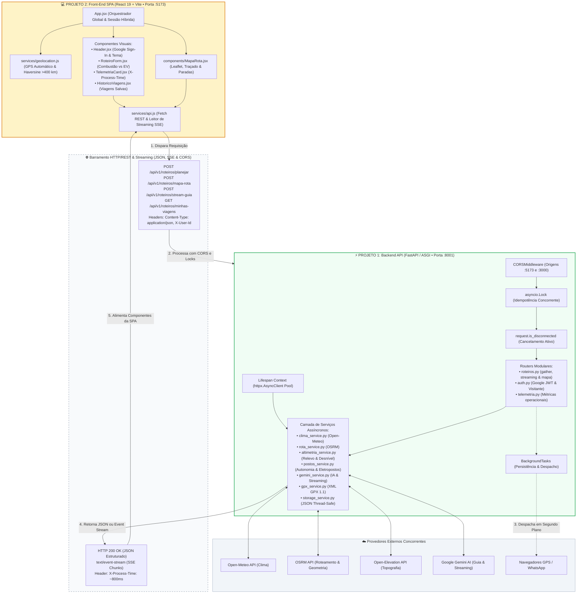

> Documento consolidado a partir da atividade didática indicada em **Fonte**. A estrutura foi convertida para Markdown, com links absolutos e diagramas Mermaid preservados.
>
> **Fonte:** [https://maykolsampaio.github.io/cursos-maykol/cursos/automacao-web-python/unidade-2/atividade-2/](https://maykolsampaio.github.io/cursos-maykol/cursos/automacao-web-python/unidade-2/atividade-2/)

# Atividade 2: Projeto FastAPI e React

---

## 1. Visão Geral

Nesta atividade prática, as equipes realizam o desacoplamento e a modernização completa do **Guia do Turista Inteligente**, evoluindo do monólito Flask para uma arquitetura orientada a serviços com **dois projetos independentes**: API REST de alta performance em **FastAPI** e front-end SPA reativo em **React 19 com Vite**.

> **Modalidade de Execução:** Equipes de 4 alunos. **Repositório GitHub:** [github.com/maykolsampaio/guia-turista-inteligente-v2](https://github.com/maykolsampaio/guia-turista-inteligente)


*Figura 2.1: Painel consolidado do Guia do Turista Brasil com orquestração assíncrona, altimetria, autonomia e IA generativa.*

---

### 1.1 Motivação Técnica

A substituição do modelo síncrono tradicional em Flask pelo ecossistema assíncrono do FastAPI soluciona gargalos estruturais de concorrência, latência e governança:

1. **Concorrência Não-Bloqueante (ASGI):** No Flask (WSGI), cada chamada externa consecutiva retém uma thread do servidor. A latência somada de 4 chamadas sequenciais alcançava ~4.000 ms. No FastAPI com Uvicorn, o *Event Loop* e o `asyncio.gather()` disparam requisições concorrentes de geocodificação, clima, traçado de rota, perfil topográfico e IA, reduzindo o tempo de resposta do servidor para ~800 ms.
2. **Streaming em Tempo Real com SSE:** A síntese narrativa de viagem gerada pelo Google Gemini é transmitida via *Server-Sent Events* (`text/event-stream`), proporcionando resposta visual imediata no front-end com fragmentos progressivos de texto em menos de 300 ms.
3. **Resiliência e Proteção Concorrente:** A API implementa detecção antecipada de desconexão (`request.is_disconnected()`), cancelando pipelines custosos se o cliente abandonar a página, e bloqueio de cliques simultâneos (`asyncio.Lock()`) para assegurar idempotência nas operações.
4. **Contratos Estritos com Pydantic v2:** Validação automática compilada em Rust (`pydantic-core`), eliminando código manual de sanitização e rejeitando payloads inválidos com resposta padronizada `HTTP 422 Unprocessable Entity`.
5. **Documentação OpenAPI 3.1 Viva:** Geração em tempo de execução dos esquemas no Swagger UI (`/docs`) e ReDoc (`/redoc`), permitindo depuração interativa de parâmetros e contratos.

---

### 1.3 Arquitetura de Microsserviços

O sistema opera em uma topologia desacoplada de microsserviços, integrando provedores geoespaciais, meteorológicos e de inteligência artificial sobre um barramento assíncrono:



---

## 2. Estrutura dos Projetos

A arquitetura do repositório foi modularizada em dois projetos independentes, garantindo separação estrita de responsabilidades entre regras de negócio no servidor e renderização reativa na interface:

---

### 2.1 Backend FastAPI

```text
guia-turista-inteligente/completo/backend/
├── app/
│   ├── core/
│   │   ├── config.py                 # Configurações Pydantic-Settings, variáveis de ambiente e CORS
│   │   ├── dependencies.py           # Injeção de dependências do FastAPI (pool httpx, usuário ativo, tokens)
│   │   ├── logging_config.py         # Logging estruturado com Correlation-ID (X-Request-ID)
│   │   ├── catalogo.py               # Destinos curados, atrativos históricos e gastronomia regional
│   │   ├── cache.py                  # Cache em memória thread-safe com TTL e expiração automática
│   │   └── circuit_breaker.py        # Circuit Breakers com fallback imediato e degradação graciosa
│   ├── routers/
│   │   ├── auth.py                   # /api/v1/auth (Google OAuth JWT, visitante com TTL 2h e encerramento)
│   │   ├── roteiros.py               # /api/v1/roteiros (/planejar, /mapa-rota, /stream-guia, /custos, /exportar/gpx)
│   │   └── telemetria.py             # /api/v1/telemetria (Métricas, Circuit Breakers, auditoria e Prometheus)
│   ├── schemas/
│   │   ├── auth.py                   # Contratos Pydantic de autenticação (TokenGoogleRequest, LoginResponse, UsuarioPerfil)
│   │   └── roteiros.py               # Contratos Pydantic v2 estritos (RoteiroRequest, MapaRotaRequest, CustosRequest, AltimetriaInfo)
│   ├── services/
│   │   ├── altimetria_service.py     # Perfil topográfico, ganho/perda de elevação e penalização de consumo
│   │   ├── clima_service.py          # Integração assíncrona com Open-Meteo via httpx.AsyncClient compartilhado
│   │   ├── custos_service.py         # Calculadora de combustível, EV, pedágios regionais, emissões ESG e rateio
│   │   ├── gemini_service.py         # Geração de guia com Google Gemini e streaming assíncrono SSE
│   │   ├── gpx_service.py            # Exportação de arquivos XML GPX 1.1 padronizados com waypoints e relevo
│   │   ├── postos_service.py         # Sugestão de abastecimento e recarga EV por autonomia calculada
│   │   ├── rota_service.py           # Roteamento OSRM assíncrono (geometria, distâncias e rotas alternativas)
│   │   └── storage_service.py        # Persistência atômica thread-safe e isolamento por usuário em arquivo JSON
│   └── main.py                       # Instância FastAPI, ciclo de vida lifespan, middlewares, probes e métricas
├── static/
│   └── data/                         # Armazenamento persistente de viagens em arquivo JSON com file lock
│       └── viagens.json              # Base de itinerários salvos agrupados por identificador de usuário
├── tests/
│   ├── conftest.py                   # Fixtures do pytest, TestClient e isolamento de ambiente
│   ├── test_roteiros.py              # Suíte abrangente de testes de concorrência, rotas, altimetria, telemetria e streaming
│   └── test_settings.py              # Testes de integridade de variáveis de ambiente e validação de configurações
├── requirements.txt                  # Dependências do backend (fastapi, uvicorn, pydantic, httpx, google-genai, pytest)
├── .env                              # Variáveis de ambiente ativas no servidor
└── .env.example                      # Gabarito de variáveis de ambiente do servidor
```

#### Responsabilidade das Camadas do Backend:

1. **`app/core/` (Infraestrutura e Políticas Transversais):** Centraliza configurações de ambiente com Pydantic-Settings (`config.py`), injeção de dependências e tokens de sessão (`dependencies.py`), logging estruturado com Correlation-ID (`logging_config.py`), catálogo de dados curados (`catalogo.py`), cache com expiração (`cache.py`) e disjuntores de circuito (`circuit_breaker.py`) que protegem o backend contra indisponibilidade de APIs externas.
2. **`app/routers/` (Exposição de Endpoints HTTP):**
    - `auth.py`: Validação de tokens Google JWT via servidores OAuth2, emissão de perfis voláteis de visitante com TTL de 2 horas e encerramento de sessão compatível com fechamento de janela (`sendBeacon`).
    - `roteiros.py`: Endpoints concorrentes `/planejar`, consulta de geometria e rotas alternativas `/mapa-rota`, transmissão em tempo real `/stream-guia`, calculadora `/custos`, exportação `/exportar/gpx`, compartilhamento em background `/compartilhar` e marcação de atrativos `PATCH /{roteiro_id}/visitas`.
    - `telemetria.py`: Exposição de métricas operacionais, contagem de roteiros gerados, status dos Circuit Breakers, despacho de auditoria em segundo plano e exportador Prometheus (`/metrics`).
3. **`app/schemas/` (Contratos de Dados com Pydantic v2):** Aplica validação estrita compilada em Rust com `pydantic-core`, utilizando `Annotated`, `Field` com limites numéricos e `@field_validator` para sanitização de cidades e siglas de UF, retornando `HTTP 422 Unprocessable Entity` em entradas inconsistentes.
4. **`app/services/` (Lógica de Negócio e Serviços Assíncronos):** Módulos assíncronos não-bloqueantes que consomem APIs externas via `httpx.AsyncClient` compartilhado, realizam cálculos matemáticos de consumo e desnível, geram streaming de IA e realizam persistência atômica thread-safe com file lock.

---

### 2.2 Frontend React 19

```text
guia-turista-inteligente/completo/frontend/
├── public/
│   ├── favicon.svg                   # Favicon temático em formato SVG
│   ├── icons.svg                     # Sprite SVG com os ícones da interface
│   └── manifest.webmanifest          # Manifesto PWA com metadados da aplicação web
├── src/
│   ├── assets/                       # Ilustrações e imagens do portal (hero.png, vite.svg, react.svg)
│   ├── components/
│   │   ├── Header.jsx                # Topbar: alternador Dark/Light, Google Sign-In e sessão híbrida
│   │   ├── RoteiroForm.jsx           # Formulário: Combustão vs EV, sugestões Haversine (>400 km) e perfis
│   │   ├── MapaRota.jsx              # Mapa Leaflet, traçado OSRM, paradas de recarga, custos integrados e altimetria
│   │   ├── RoteiroResult.jsx         # Apresentação do clima, guia via streaming de IA e catálogo de atrativos
│   │   ├── TelemetriaCard.jsx        # Estatísticas de latência (X-Process-Time), Correlation-ID e métricas
│   │   ├── HistoricoViagens.jsx      # Lista reativa de viagens salvas com exclusão pontual
│   │   ├── BotoesControleViagem.jsx  # Ações rápidas: Abrir no Maps, WhatsApp e download de arquivo GPX 1.1
│   │   ├── ErrorBoundary.jsx         # Barreira de contenção para tratamento resiliente de erros na UI
│   │   ├── Toast.jsx                 # Notificações flutuantes acessíveis (sucesso, erro, informativo)
│   │   └── Footer.jsx                # Rodapé semântico HTML5 com créditos pedagógicos
│   ├── hooks/
│   │   ├── useAuth.js                # Hook customizado de controle de identidade Google e visitante
│   │   ├── useTheme.js               # Hook para alternância e persistência de temas Claro/Escuro (data-theme)
│   │   ├── useToasts.js              # Gerenciador global de notificações temporizadas flutuantes
│   │   ├── useNetworkStatus.js       # Monitoramento do status online/offline de conexão do navegador
│   │   ├── useSessionTimer.js        # Temporizador regressivo da sessão temporária de visitante (2 horas)
│   │   └── useViagem.js              # Estado compartilhado de planejamento, telemetria, custos e histórico
│   ├── services/
│   │   ├── api.js                    # Comunicação assíncrona REST (Fetch API com X-User-Id e leitor de SSE)
│   │   ├── geolocation.js            # GPS do navegador via navigator.geolocation e cálculo de Haversine
│   │   └── visitanteStorage.js       # Gerenciador de cache local seguro no localStorage
│   ├── types/
│   │   └── schemas.js                # Contratos defensivos de validação e sanitização de dados no front-end
│   ├── App.jsx                       # Orquestrador do layout principal e integração entre os componentes
│   ├── index.css                     # Design System Semântico (tokens M3, modo escuro e acessibilidade WCAG)
│   ├── config.js                     # Variáveis de configuração da SPA (URL da API e Google Client ID)
│   ├── setupTests.js                 # Inicialização do ambiente de testes unitários com Vitest
│   └── main.jsx                      # Ponto de montagem da aplicação React 19 no DOM
├── index.html                        # HTML5 semântico com Google Identity Services e biblioteca Leaflet CSS
├── package.json                      # Dependências da aplicação (React 19, Leaflet, Vitest, oxlint)
├── vite.config.js                    # Configuração de build, plugins e servidor de desenvolvimento do Vite
└── .env.example                      # Gabarito de variáveis de ambiente da aplicação cliente
```

#### Responsabilidade dos Módulos do Front-End:

1. **`src/components/` (Componentização Semântica e Acessível):**
    - `Header.jsx`: Barra de navegação semântica `<header>` com alternador de tema e integração com o Google Identity Services.
    - `RoteiroForm.jsx`: Formulário unificado sem redundâncias, com sugestões de proximidade via GPS e parâmetros de veículo.
    - `MapaRota.jsx`: Renderização de rotas com Leaflet, cálculo de paradas estratégicas por autonomia, painel de custos de combustível/energia, divisão de despesas por passageiro e perfil altimétrico de relevo (unificação sob o princípio *Single Source of Truth*).
    - `RoteiroResult.jsx`: Cards de clima, guia formatado via streaming SSE e catálogo de pontos turísticos e gastronomia com controle de visitas.
    - `TelemetriaCard.jsx`: Painel informativo com medição de latência do backend, rastreabilidade por Correlation-ID e tempo total percebido pelo usuário.
    - `HistoricoViagens.jsx`: Lista reativa `<aside>` de viagens salvas com exclusão imediata via chamada REST.
    - `BotoesControleViagem.jsx`: Ações rápidas de exportação para arquivos GPX 1.1, compartilhamento via WhatsApp e rota no Google Maps.
    - `ErrorBoundary.jsx` e `Toast.jsx`: Barreira defensiva contra falhas de renderização e notificações acessíveis com feedback sonoro/visual.
    - Suíte de testes automatizados (`*.test.jsx`): Cobertura unitária de componentes, formulários e fluxos com Vitest e Testing Library.
2. **`src/hooks/` (Hooks Customizados e Reutilização de Estado):** Separam lógica de negócio dos componentes de apresentação, gerenciando sessão (`useAuth`), tema visual (`useTheme`), notificações (`useToasts`), rede (`useNetworkStatus`), expiração de visitante (`useSessionTimer`) e orquestração de viagens (`useViagem`).
3. **`src/services/` (Comunicação e Inteligência Cliente):**
    - `api.js`: Cliente assíncrono que encapsula chamadas `fetch()`, headers de autenticação, captura de latência e consumo de fluxos SSE via `ReadableStream`.
    - `geolocation.js`: Extração de coordenadas via `navigator.geolocation` e cálculo geodésico de distâncias com a Fórmula de Haversine.
    - `visitanteStorage.js`: Gerenciamento defensivo no `localStorage` para persistência temporária da sessão anônima.
4. **`src/App.jsx` (Orquestrador Global):** Controla o estado unificado da aplicação, carregamento assíncrono, limpeza defensiva de dados na troca de modo e sincronização reativa entre formulário, mapa e cards de resultado.
5. **`src/index.css` (Design System Semântico):** Design tokens compatíveis com Material Design 3, alternância dinâmica de modo claro e escuro, acessibilidade WCAG 2.1 AA e layouts responsivos em CSS Grid e Flexbox sem dependência de frameworks externos.

---

## 3. Telas e Componentes

A interface do front-end SPA foi projetada sob o **Design System Semântico** para fornecer ergonomia visual, alta reatividade e conformidade rigorosa com acessibilidade WCAG 2.1 AA.

---

### 3.1 Planejador de Viagens

O formulário central consolida todos os parâmetros de entrada da viagem em uma única fonte de verdade, evitando campos redundantes:


*Figura 3.1: Formulário de planejamento com sugestões espaciais, seleção energética e parametrização avançada.*

#### Funcionalidades Integradas:

1. **Campos de Município e Estado:** Autocomplete de cidades brasileiras com validação rigorosa de UF (2 letras maiúsculas).
2. **Recomendação Dinâmica no Raio (>400 km):** Botões de acesso rápido que utilizam o GPS do navegador e a fórmula de Haversine para listar os 4 destinos turísticos mais próximos em distância viável para viagens rodoviárias.
3. **Seletor de Propulsão (Combustão vs. 100% Elétrico):**
    - *Combustão:* Configuração de consumo médio (km/l), capacidade do reservatório (litros) e preço por litro.
    - *100% Elétrico (EV):* Configuração de eficiência energética (km/kWh), capacidade da bateria (kWh) e preço por kWh.
4. **Duração da Viagem (1 a 5 dias):** Define o volume de planejamento diário a ser sintetizado pela inteligência artificial.
5. **Perfil do Viajante:** Categorias selecionáveis (*Cultural*, *Gastronômico*, *Ecoturismo / Aventura*, *Família*, *Econômico*).
6. **Bloqueio Idempotente:** Ao submeter, o botão desativa imediatamente prevenindo requisições concorrentes duplicadas (`HTTP 409 Conflict`).

---

### 3.2 Telemetria e Desempenho

O card de telemetria fornece transparência técnica sobre o comportamento assíncrono do sistema:


*Figura 3.2: Métricas de latência do middleware HTTP, tempo percebido pelo cliente e diagnóstico dos provedores.*

#### Indicadores Operacionais:

1. **Usuário Ativo:** Exibe o titular da sessão ativa (*Google Conectado* com identificador mascarado ou *Visitante Temporário*).
2. **Latência da API (`X-Process-Time`):** Tempo em milissegundos medido diretamente pelo servidor ASGI via `time.perf_counter()`.
3. **Tempo Total do Front-End:** Duração completa do ciclo disparada no `fetch()` e finalizada na renderização reativa dos componentes.
4. **Provedores Ativados (4/4):** Indicador de disponibilidade dos serviços simultâneos: Open-Meteo, OSRM, Gemini AI e Open-Elevation.
5. **Painel de Métricas:** Contadores rápidos de total de roteiros no sistema, latência recente e conexões ativas.

---

### 3.3 Mapa e Autonomia

O componente `MapaRota.jsx` exibe o traçado rodoviário no Leaflet com marcadores de paradas estratégicas e perfil de relevo:


*Figura 3.3: Traçado geográfico da rodovia, postos de recarga/combustível por autonomia e análise altimétrica de relevo.*

#### Recursos Avançados do Mapa:

1. **Badges Métricos:** Distância percorrida (km), tempo estimado de viagem, pedágios calculados por praça regional, autonomia do veículo e desnível topográfico (+3285 m de subida / -4021 m de descida).
2. **Seleção de Rotas Alternativas:** Abas interativas que alternam entre *Sugestão 01 (Rodovia Principal / Menor Tempo)* e *Sugestão 02 (Rodovias Federais / Mais Econômica)*, recalculando métricas de tempo e combustível em tempo real.
3. **Paradas Estratégicas por Autonomia:** Algoritmo que projeta o nível da bateria ou tanque ao longo do percurso e posiciona postos/eletropostos antes que a reserva atinja o limite crítico (margem de segurança de ~18%).
4. **Sanfona de Topografia & Relevo:** Expande o perfil altimétrico, informando altitude máxima, desnível líquido e penalização/ganho percentual no consumo nominal provocado por trechos de serra.
5. **Calculadora e Rateio entre Passageiros:** Apresenta o custo total previsto (combustível/energia + pedágios) com divisão automática do valor em cotas individuais para até 8 passageiros.
6. **Ações Rápidas de Navegação:** Botões dedicados para abrir o trajeto no Google Maps, compartilhar o resumo no WhatsApp e realizar download do arquivo GPX 1.1 para dispositivos GPS.

---

### 3.4 Histórico e Persistência

A lista de viagens salvas gerencia o histórico de consultas persistido pelo backend em segundo plano:


*Figura 3.4: Histórico de viagens salvas sincronizado assincronamente com persistência atômica em JSON.*

#### Características da Persistência:

1. **Desacoplamento por `BackgroundTasks`:** A gravação da nova consulta no armazenamento ocorre em segundo plano após o retorno da resposta HTTP, assegurando que o usuário receba os dados sem latência de disco.
2. **Isolamento por Usuário (`X-User-Id`):** Cada usuário autenticado mantém seu próprio catálogo de viagens isolado no arquivo JSON.
3. **Exclusão Reativa:** Remoção imediata de itinerários via chamada assíncrona `DELETE /api/v1/roteiros/{roteiro_id}` com atualização instantânea na interface.

---

### 3.5 Guia e Streaming

A seção inferior da aplicação agrupa o clima do destino, o guia gerado por IA e o catálogo de atrativos:


*Figura 3.5: Clima meteorológico do destino, guia com streaming SSE e marcação interativa de atrativos visitados.*

#### Componentes de Conteúdo:

1. **Banner Meteorológico:** Temperatura atual, sensação térmica, vento e condições climáticas obtidas do Open-Meteo.
2. **Guia do Viajante via Streaming (SSE):** O endpoint `/stream-guia` transmite os parágrafos gerados pelo Gemini AI sob demanda, exibindo o conteúdo na tela enquanto o modelo ainda está sintetizando as frases.
3. **Atrativos e Gastronomia Interativos:** Cards detalhados com botão de marcação de locais visitados, despachando atualizações em tempo real para o endpoint `PATCH /api/v1/roteiros/{roteiro_id}/visitas`.

#### Diretriz de Síntese e Concisão do Roteiro (Gemini AI):

O prompt de sistema da inteligência artificial generativa foi calibrado para eliminar prolixidade, adjetivação excessiva e parágrafos extensos. O modelo atua como um assistente de bordo ágil e ultra-objetivo, entregando um roteiro minimalista para leitura imediata na tela do dispositivo móvel:


*Figura 3.6: Guia do Viajante simplificado e conciso gerado pelo Gemini AI, adaptado ao contexto meteorológico do destino.*

- **Identidade e Atmosfera Local:** Apenas 1 frase direta (máximo de 20 palavras) resumindo a essência cultural e histórica do município.
- **Roteiro Sugerido (Turnos):** Divisão estrita em **Manhã**, **Tarde** e **Noite** (ou dias numerados), contendo exatamente 1 frase de ação direta por turno (máximo de 15 palavras cada).
- **Tradições Gastronômicas:** 1 frase concisa indicando de 2 a 3 pratos ou sabores emblemáticos e onde saboreá-los.
- **Orientações Práticas e Clima:** 1 frase funcional conectando os dados reais de temperatura e tempo da telemetria ao vestuário e horários recomendados.

---

### 3.6 Sessão Híbrida

A barra superior organiza a identidade visual, temas e o mecanismo de preservação de sessão:


*Figura 3.7: Barra de navegação com alternância de tema e controle de sessão híbrida não destrutiva.*

#### Mecanismo de Preservação:

- **Alternância para Modo Visitante:** Ao clicar para usar como visitante, a conta Google conectada não é desconectada. Ela permanece salva em `guia_turista_saved_google_user` no `localStorage`.
- **Restauração em 1 Clique:** O visitante pode navegar livremente e, a qualquer momento, clicar no botão *"Voltar para [Nome]"* no cabeçalho para restaurar instantaneamente seu histórico corporativo sem necessitar de uma nova autenticação no Google.

---

## 4. Engenharia Assíncrona

Abaixo estão os padrões arquiteturais fundamentais que tornam a solução robusta e não-bloqueante.

---

### 4.1 Orquestração com `asyncio.gather`

No endpoint central `/api/v1/roteiros/planejar`, o processamento é dividido em dois estágios paralelos, utilizando o pool de conexões `httpx.AsyncClient` compartilhado:

**backend/app/routers/roteiros.py (Estágios Concorrentes)**

```python
    # Detecção precoce de cancelamento do cliente
    if await request.is_disconnected():
        raise HTTPException(status_code=499, detail="Requisição cancelada pelo cliente.")

    # Estágio 1: Geocodificação paralela de Origem e Destino
    (lat_o, lon_o, nome_o), (lat_d, lon_d, nome_d) = await asyncio.gather(
        buscar_coordenadas_async(client, payload.origem_cidade, payload.origem_uf),
        buscar_coordenadas_async(client, payload.destino_cidade, payload.destino_uf),
    )

    if await request.is_disconnected():
        raise HTTPException(status_code=499, detail="Requisição cancelada pelo cliente.")

    # Estágio 2: Orquestração concorrente de Clima e Rota rodoviária OSRM
    (dados_clima, t_clima), (dados_percurso, t_rota) = await asyncio.gather(
        _executar_cronometrado(obter_clima_async(client, lat_d, lon_d)),
        _executar_cronometrado(
            calcular_rota_osrm_async(
                client,
                lat_o,
                lon_o,
                lat_d,
                lon_d,
                preferencia_rota=payload.preferencia_rota,
            )
        ),
    )

    # Estágio 3: Síntese de IA com Gemini alimentada por dados reais de clima e perfil
    guia_texto, diag_ia = await gerar_guia_ia_async(
        destino=nome_d,
        dias_estadia=payload.dias_estadia,
        estilo_viagem=payload.estilo_viagem,
        clima_info=dados_clima,
        atrativos=atrativos,
        gastronomia=gastronomia,
    )
```

1. **Compartilhamento de Conexões:** O cliente HTTP é injetado via `Depends(obter_http_client)` a partir do `app.state.http_client` configurado no `lifespan` do FastAPI, reaproveitando conexões TCP/TLS abertas (*keep-alive*).
2. **Paralelismo Duplo:** Geocodifica duas cidades simultaneamente no Estágio 1 e consulta meteorologia e roteamento no Estágio 2 em paralelo.

---

### 4.2 Streaming com SSE

Para evitar que o usuário aguarde passivamente vários segundos pela resposta integral da inteligência artificial, o endpoint `/stream-guia` utiliza *Server-Sent Events*:

**backend/app/routers/roteiros.py (Server-Sent Events)**

```python
@router.post("/stream-guia", summary="Geração de Guia por IA em Streaming (SSE)")
async def stream_guia_ia(payload: GuiaStreamRequest, request: Request):
    """Endpoint de Server-Sent Events (SSE) para transmissão em tempo real do guia."""

    async def evento_generator():
        try:
            async for chunk in gerar_guia_ia_stream_async(
                destino=payload.destino,
                dias_estadia=payload.dias_estadia,
                estilo_viagem=payload.estilo_viagem,
                clima_info=payload.clima_info,
                atrativos=payload.atrativos,
                gastronomia=payload.gastronomia,
            ):
                if await request.is_disconnected():
                    break
                payload_sse = json.dumps({"chunk": chunk, "done": False}, ensure_ascii=False)
                yield f"data: {payload_sse}\n\n"

            # Evento sinalizador de término do streaming
            yield f"data: {json.dumps({'chunk': '', 'done': True})}\n\n"
        except Exception as exc:
            erro_sse = json.dumps({"chunk": f"\n\n[Erro no streaming: {exc}]", "done": True})
            yield f"data: {erro_sse}\n\n"

    return StreamingResponse(
        evento_generator(),
        media_type="text/event-stream",
        headers={
            "Cache-Control": "no-cache",
            "Connection": "keep-alive",
            "X-Accel-Buffering": "no",
        },
    )
```

- **Consumo no Front-End:** O cliente React lê o fluxo utilizando `ReadableStream` (`response.body.getReader()`), decodificando os blocos de texto e anexando os caracteres progressivamente ao estado sem piscar a tela.

---

### 4.3 Idempotência e Bloqueios

Para proteger o servidor contra usuários impacientes que clicam repetidamente no botão de planejamento, a aplicação emprega um bloqueio concorrente não-bloqueante com `asyncio.Lock`:

**backend/app/routers/roteiros.py (Controle de Concorrência)**

```python
REQUISICOES_ATIVAS: set[str] = set()
lock_requisicoes = asyncio.Lock()

# Dentro do endpoint:
chave_requisicao = f"{user_id_ativo}:{payload.origem_cidade}_{payload.origem_uf}->{payload.destino_cidade}_{payload.destino_uf}".lower().strip()

async with lock_requisicoes:
    if chave_requisicao in REQUISICOES_ATIVAS:
        raise HTTPException(
            status_code=status.HTTP_409_CONFLICT,
            detail="Já existe uma requisição em andamento para este mesmo roteiro. Aguarde a conclusão da consulta ativa.",
        )
    REQUISICOES_ATIVAS.add(chave_requisicao)

try:
    # Executa o pipeline assíncrono completo...
    pass
finally:
    async with lock_requisicoes:
        REQUISICOES_ATIVAS.discard(chave_requisicao)
```

---

### 4.4 Detecção de Desconexão

Sempre que um usuário fecha a aba do navegador ou clica em outro destino, o FastAPI detecta o encerramento do canal TCP via `await request.is_disconnected()`:

```python
if await request.is_disconnected():
    raise HTTPException(status_code=499, detail="Requisição cancelada pelo cliente.")
```

- **Economia de Recursos:** Interrompe chamadas de rede externas e cálculos pesados, descartando o salvamento de viagens incompletas.

---

### 4.5 Tarefas em Segundo Plano

O `BackgroundTasks` é utilizado para executar procedimentos que não precisam bloquear a resposta imediata entregue ao navegador:

```python
# 1. Persistência da viagem sem reter a entrega do JSON
if not await request.is_disconnected():
    background_tasks.add_task(
        salvar_nova_viagem, user_id=user_id_ativo, roteiro=resposta.model_dump()
    )

# 2. Despacho assíncrono de notificações e webhooks
background_tasks.add_task(
    despachar_compartilhamento_background,
    roteiro_id=roteiro_id,
    canal=payload.canal,
    destinatario=payload.destinatario or "contato@guiadoturista.com.br",
)
```

---

## 5. Instalação e Execução

Para executar o ecossistema completo em ambiente de desenvolvimento, utilize dois terminais abertos simultaneamente:

---

### 5.1 Backend FastAPI

```bash
# Para executar a solução completa de referência:
cd cursos/automacao-web-python/unidade-2/projetos/guia-turista-inteligente/completo/backend

# Ou para executar o Starter Kit dos alunos:
# cd cursos/automacao-web-python/unidade-2/projetos/guia-turista-inteligente/alunos/backend

python3 -m venv .venv
source .venv/bin/activate
pip install --upgrade pip
pip install -r requirements.txt
cp .env.example .env
```

> Configure sua chave `GEMINI_API_KEY` e o `GOOGLE_CLIENT_ID` no arquivo `.env`. Inicie a API com Uvicorn na porta **8001**:

```bash
uvicorn app.main:app --reload --port 8001
```

- **API REST Online:** [http://localhost:8001](http://localhost:8001)
- **Documentação Swagger UI:** [http://localhost:8001/docs](http://localhost:8001/docs)
- **Documentação ReDoc:** [http://localhost:8001/redoc](http://localhost:8001/redoc)
- **Probes de Saúde e Orquestração:** [http://localhost:8001/healthz](http://localhost:8001/healthz) e [http://localhost:8001/readyz](http://localhost:8001/readyz)
- **Métricas OpenMetrics / Prometheus:** [http://localhost:8001/metrics](http://localhost:8001/metrics)

#### Execução da Suíte de Testes do Backend:

```bash
pytest tests/ -v
```

---

### 5.2 Frontend React

```bash
# Para executar o frontend da solução completa:
cd ../frontend

# Instalação das dependências e servidor de desenvolvimento
npm install
npm run dev
```

- **Aplicação Web SPA:** [http://localhost:5173](http://localhost:5173)

#### Execução de Testes e Qualidade do Frontend:

```bash
# Execução da suíte de testes unitários com Vitest
npm test

# Verificação estática de código com oxlint
npm run lint
```

---

## 6. Dinâmica da Apresentação

A apresentação de cada equipe terá a **duração total de 20 a 30 minutos** (tempo global gerenciado com autonomia pela equipe para a apresentação dos 4 integrantes, seguido das considerações finais e arguição do professor):


---

### 6.1 Matriz de Responsabilidades

| Ordem / Papel | Código Implementado | O Que Deve Ser Explicado pelo Aluno |
| --- | --- | --- |
| **1º — Aluno 1** *(Frontend Developer)* | • `src/services/api.js` • `src/services/geolocation.js` • `src/components/MapaRota.jsx` • `src/App.jsx` • `src/index.css` | Demonstrar a SPA (:5173) e explicar a integração assíncrona com a API (Fetch REST e SSE), geolocalização com cálculo geodésico de Haversine (>400 km), renderização de rotas e paradas de recarga no Leaflet, tokens do Design System (`index.css`) e fluxo de sessão híbrida (Google e visitante). |
| **2º — Aluno 2** *(Backend Core Engineer)* | • `app/main.py` • `app/routers/roteiros.py` (`/planejar`) • `app/core/dependencies.py` • `app/core/circuit_breaker.py` | Demonstrar a rota com tempo de resposta inferior a 1.000 ms e explicar a arquitetura ASGI/FastAPI: concorrência paralela com `asyncio.gather()` duplo no endpoint `/planejar`, gerenciamento do pool HTTP no `lifespan`, cancelamento ativo com `request.is_disconnected()`, disjuntores de circuito (`CircuitBreaker`) e injeção de dependências. |
| **3º — Aluno 3** *(Data & Altimetry Engineer)* | • `app/schemas/roteiros.py` • `app/services/altimetria_service.py` • `app/services/postos_service.py` • `app/services/custos_service.py` | Demonstrar a validação de entrada (erro `HTTP 422` para UF inválida), sanfona de topografia e painel de custos, explicando as validações defensivas do Pydantic v2 com `@field_validator`, consulta à Open-Elevation, penalização altimétrica no consumo e cálculo de autonomia com rateio por passageiro. |
| **4º — Aluno 4** *(DevOps, QA & Streaming Lead)* | • `/stream-guia` (SSE) • `app/services/gemini_service.py` • `app/services/gpx_service.py` • `backend/tests/test_roteiros.py` • `frontend/*.test.jsx` (Vitest) | Demonstrar o streaming em tempo real via SSE e download do arquivo GPX 1.1, explicando a implementação com `StreamingResponse`, bloqueio de concorrência com `asyncio.Lock()` (`HTTP 409`), métricas Prometheus de telemetria e execução dos testes automatizados com `pytest` e Vitest com 100% de aprovação. |

> **Defesa Individual Obrigatória**
>
> - Cada aluno apresenta e defende exclusivamente as partes do código que implementou.
> - Não há tempo limite individual prefixado por integrante; a equipe gerencia a distribuição dos 20 a 30 minutos totais entre as 4 partes e a arguição técnica.
> - A nota individual e o resultado consolidado da equipe dependem estritamente do domínio técnico demonstrado durante cada apresentação.

---

## 7. Critérios de Avaliação

A avaliação é individualizada e baseia-se unicamente nas apresentações individuais de cada aluno:

1. **Apresentações Individuais (0 a 10):** Cada integrante é avaliado de forma independente com base no domínio conceitual, na clareza e na precisão técnica durante a defesa do código que implementou, dentro do tempo reservado para a equipe.
2. **Média Final da Equipe:** O resultado consolidado da equipe é composto exclusivamente pela média aritmética simples das notas obtidas nas apresentações individuais de cada aluno.

---

## 8. Gabarito do Professor

> **🔒 Gabarito Bloqueado pelo Professor**
>
> O gabarito oficial deste projeto prático ainda não foi liberado. Desenvolva a aplicação desacoplada com sua equipe a partir do Starter Kit e realize a demonstração prática na data agendada.

---
