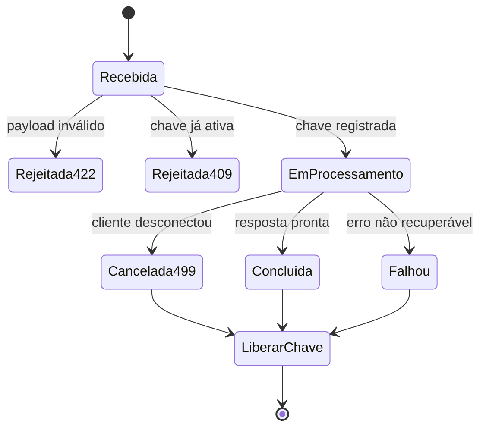

# Erros, cancelamento e idempotência

## Objetivo

Padronizar o comportamento observável da API sem atribuir à fonte contratos que ela não define.

**Rastreabilidade:** [Motivação Técnica](../modulo-guia-turista-inteligente.md#11-motivação-técnica), [Idempotência e Bloqueios](../modulo-guia-turista-inteligente.md#43-idempotência-e-bloqueios) e [Detecção de Desconexão](../modulo-guia-turista-inteligente.md#44-detecção-de-desconexão).

## Códigos confirmados

| Código | Condição | Estado | Comportamento esperado |
| --- | --- | --- | --- |
| `200` | operação concluída ou stream iniciado | Fonte | JSON estruturado ou SSE, conforme endpoint |
| `409` | já existe planejamento ativo para a mesma chave | Fonte | não iniciar segundo pipeline |
| `422` | payload viola contrato Pydantic | Fonte | retornar detalhes de validação sem executar integrações |
| `499` | cliente desconectou durante trabalho custoso | Fonte | interromper pipeline e não persistir resposta incompleta |

Outros códigos usuais (`400`, `401`, `403`, `404`, `429`, `500`, `502`, `503`, `504`) são **propostos**, não confirmados. Devem ser associados a casos concretos antes de entrar no contrato OpenAPI.

## Envelope de erro

FastAPI fornece `detail` por padrão, mas a fonte não estabiliza um envelope. Proposta para discussão:

```json
{
  "error": {
    "code": "ROTEIRO_EM_ANDAMENTO",
    "message": "Já existe uma requisição em andamento para este roteiro.",
    "request_id": "<correlation-id>",
    "details": []
  }
}
```

Requisitos da proposta:

- `code` é estável e próprio para máquinas;
- `message` é seguro para exibição;
- `request_id` liga cliente, resposta e logs;
- `details` contém violações de campo quando aplicável;
- stack trace, segredo e resposta bruta de provedor nunca são expostos.

## Chave de concorrência

Na implementação de referência:

```text
{user_id}:{origem_cidade}_{origem_uf}->{destino_cidade}_{destino_uf}
```

A chave é normalizada com `lower().strip()` e protegida por `asyncio.Lock`.

### Garantia atual

- impede simultaneamente dois pipelines com mesma rota para um usuário dentro do mesmo processo;
- remove a chave em `finally`, inclusive quando ocorre exceção;
- não torna a operação idempotente após sua conclusão;
- não coordena múltiplos workers ou réplicas.

### Decisões pendentes

- incluir dias, perfil, preferência e veículo na chave;
- adotar `Idempotency-Key` fornecida pelo cliente;
- armazenar resultado de chave concluída por uma janela de tempo;
- usar coordenação distribuída em implantação com múltiplas réplicas.

## Estado da requisição



## Erros no SSE

A referência encerra o stream com:

```json
{"chunk":"[Erro no streaming: ...]","done":true}
```

**Risco:** interpolar a exceção pode revelar detalhes internos.  
**Proposto:** enviar um evento tipado e registrar o detalhe apenas no backend:

```text
event: error
data: {"code":"GUIA_STREAM_INTERROMPIDO","message":"Não foi possível concluir o guia.","done":true}
```

Como esta proposta muda o contrato de referência, deve ser aprovada e documentada no cliente antes da implementação.

## Falhas de provedores

O circuit breaker pode fornecer fallback, mas a fonte não mapeia falhas a códigos HTTP. A equipe precisa definir uma matriz por provedor, considerando:

- resposta parcial versus falha total;
- dado de cache versus ausência do bloco;
- código HTTP externo versus código de domínio;
- impacto no indicador de provedores ativos;
- se a viagem deve ser persistida quando estiver degradada.

## Observabilidade de erros

Para cada falha, registrar de modo estruturado:

- `X-Request-ID`;
- rota e método;
- código de domínio;
- duração e estágio do pipeline;
- provedor envolvido, sem payload sensível;
- estado do circuit breaker;
- cancelamento esperado (`499`) separado de falha interna.

