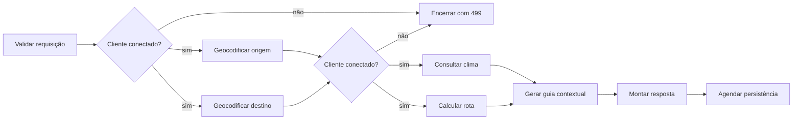
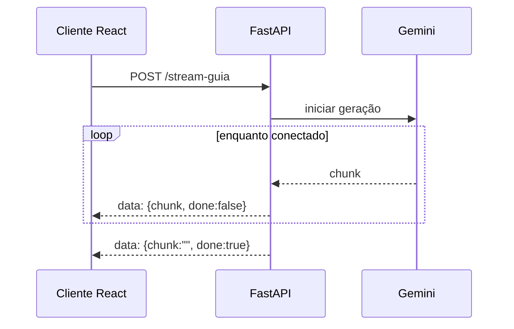

# Assincronicidade e resiliência

## Objetivo

Reduzir latência de I/O, impedir trabalho desperdiçado e limitar o impacto de duplicidade, desconexões e falhas de provedores.

**Estado:** Fonte, com invariantes derivadas e decisões propostas destacadas.  
**Rastreabilidade:** [Motivação Técnica](../modulo-guia-turista-inteligente.md#11-motivação-técnica) e [Engenharia Assíncrona](../modulo-guia-turista-inteligente.md#4-engenharia-assíncrona).

## Pipeline concorrente



`asyncio.gather()` é usado somente entre operações independentes. A geração do guia depende de clima e demais dados e, portanto, ocorre após os estágios que a alimentam.

## Pool HTTP

- Uma instância de `httpx.AsyncClient` pertence ao ciclo de vida da aplicação.
- Endpoints recebem o cliente por injeção de dependência.
- O pool reutiliza conexões e reduz custo TCP/TLS.
- **Proposto:** limites de conexão, timeouts e encerramento devem ser centralizados em configuração.

## Controle de duplicidade

A fonte define:

```text
chave = usuário + origem/UF + destino/UF
```

Um `asyncio.Lock` protege o conjunto em memória `REQUISICOES_ATIVAS`:

1. construir e normalizar a chave;
2. adquirir o lock;
3. rejeitar com `HTTP 409` se a chave já existir;
4. registrar a chave e liberar o lock;
5. executar o pipeline fora da seção crítica;
6. remover a chave em `finally`, novamente sob lock.

**Invariantes derivadas:**

- nunca manter o lock durante chamadas externas;
- sempre remover a chave em `finally`;
- o bloqueio atual é local ao processo e não coordena múltiplas réplicas;
- a chave descrita não inclui todos os parâmetros da viagem, portanto duas solicitações com mesma rota e opções diferentes podem colidir.

Os dois últimos pontos exigem decisão antes de implantação distribuída.

## Cancelamento por desconexão

No endpoint de planejamento, uma tarefa observa a mensagem `http.disconnect` do
protocolo ASGI enquanto outra executa o pipeline. Quando a desconexão é observada,
o endpoint cancela e aguarda o encerramento da tarefa de planejamento, e encerra a
tarefa observadora ao final de qualquer requisição. `asyncio.CancelledError` se
propaga; não é convertido em fallback nem contado como falha de provedor. Como o
cliente já se desconectou, não há garantia de que ele receba ou observe um status
HTTP específico, incluindo 499.

- não agendar persistência de roteiro incompleto;
- interromper o gerador SSE quando o cliente fechar a conexão;
- `asyncio.gather()` propaga o cancelamento às operações assíncronas ainda pendentes;
- a persistência só começa depois da conclusão dos dados do roteiro. Como ela usa
  `asyncio.to_thread()`, um cancelamento depois do início não interrompe a escrita
  que já está executando; nesse caso, somente um roteiro completo pode terminar de
  ser persistido.
- a geração Gemini usa uma thread para a chamada síncrona do SDK. Cancelar sua
  `Future` impede trabalho ainda não iniciado, mas não interrompe uma chamada que
  já começou. A chamada usa o executor compartilhado do event loop, que é encerrado
  com o loop; o timeout do SDK limita a duração do trabalho e a thread é liberada
  quando o SDK retorna. Um trabalho já iniciado pode prolongar o encerramento do
  loop até atingir esse timeout.

O observador de desconexão é encerrado quando o planejamento termina, evitando
deixar uma tarefa de leitura ASGI pendente após a resposta.

## Streaming SSE

O endpoint produz eventos `data:` em `text/event-stream` e finaliza com `done: true`.



Headers explícitos na fonte:

- `Cache-Control: no-cache`;
- `Connection: keep-alive`;
- `X-Accel-Buffering: no`.

Em erro durante o fluxo, a implementação de referência envia um último evento com descrição de erro e `done: true`. **Proposto:** estabilizar um campo de erro próprio, sem expor detalhes internos da exceção.

## Circuit breaker e cache

- `circuit_breaker.py` protege integrações indisponíveis e permite fallback imediato.
- `cache.py` mantém entradas em memória com TTL.
- **Questões em aberto:** limiares, janela de falhas, duração do estado aberto, política half-open, TTL por dado e conteúdo de cada fallback.

## BackgroundTasks

Adequado na fonte para persistência e despacho que não precisam bloquear a resposta. Não deve ser usado para trabalho que exija garantia durável sem que seja definida uma fila externa.

**Proposto:** registrar falha da tarefa e permitir reconciliação; `BackgroundTasks` executa no processo da API e não equivale a um broker persistente.

## Metas e medição

| Sinal | Expectativa da fonte | Medição |
| --- | --- | --- |
| planejamento | resposta do servidor em torno de 800 ms e demonstração abaixo de 1.000 ms | `X-Process-Time` e histograma Prometheus |
| primeiro conteúdo de IA | fragmentos iniciais em menos de 300 ms | tempo até primeiro evento SSE |
| provedores | indicador 4/4 quando todos estão operacionais | métrica/status por integração |

Os números são metas declaradas na atividade, não garantia universal. O ambiente e a metodologia de teste precisam ser definidos.
