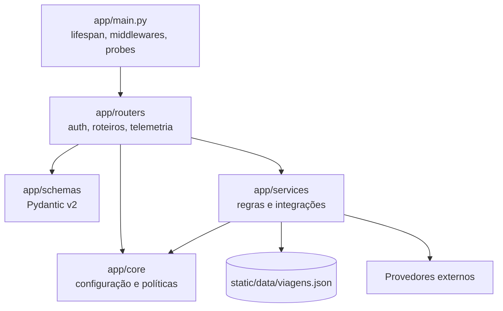

# Arquitetura do backend

## Responsabilidade

O backend FastAPI é o limite confiável do sistema: valida dados, resolve identidade, coordena chamadas externas, calcula informações de viagem, entrega respostas REST/SSE, persiste histórico e publica telemetria.

Sua raiz será `app/backend` dentro do monorepo. Os caminhos internos `app/...` abaixo são relativos a esse workspace.

**Estado:** Fonte, com decomposição derivada.  
**Rastreabilidade:** [Backend FastAPI](../modulo-guia-turista-inteligente.md#21-backend-fastapi) e [Engenharia Assíncrona](../modulo-guia-turista-inteligente.md#4-engenharia-assíncrona).

## Estrutura de referência

A fonte apresenta o backend em `guia-turista-inteligente/completo/backend/`. No monorepositório adotado pelo projeto, essa raiz corresponde a `app/backend/`; os caminhos da árvore abaixo são relativos a esse workspace.

```text
app/backend/
├── app/
│   ├── core/
│   │   ├── config.py                 # Pydantic Settings, variáveis de ambiente e CORS
│   │   ├── dependencies.py           # Injeção de dependências FastAPI e pool HTTP
│   │   ├── logging_config.py         # Logging estruturado com X-Request-ID
│   │   ├── catalogo.py               # Destinos, atrativos e gastronomia curados
│   │   ├── cache.py                  # Cache em memória com TTL e expiração
│   │   └── circuit_breaker.py        # Proteção contra falhas e degradação graciosa
│   ├── routers/
│   │   ├── auth.py                   # Google OAuth JWT e sessão visitante
│   │   ├── roteiros.py               # Planejamento, mapa, streaming, custos e GPX
│   │   └── telemetria.py             # Auditoria, circuit breakers e Prometheus
│   ├── schemas/
│   │   ├── auth.py                   # Contratos Pydantic de autenticação
│   │   └── roteiros.py               # Contratos Pydantic v2 de roteiros
│   ├── services/
│   │   ├── altimetria_service.py     # Perfil topográfico e efeito no consumo
│   │   ├── clima_service.py          # Integração assíncrona com Open-Meteo
│   │   ├── custos_service.py         # Combustível, EV, pedágios, emissões e rateio
│   │   ├── gemini_service.py         # Guia turístico e streaming SSE
│   │   ├── gpx_service.py            # Exportação de arquivos GPX 1.1
│   │   ├── postos_service.py         # Sugestões de abastecimento e recarga
│   │   ├── rota_service.py           # Rotas OSRM, geometria e alternativas
│   │   └── storage_service.py        # Persistência JSON atômica por usuário
│   └── main.py                       # Aplicação, lifespan, middlewares e probes
├── static/
│   └── data/
│       └── viagens.json              # Histórico persistido por identificador de usuário
├── tests/
│   ├── conftest.py                   # Fixtures e isolamento dos testes
│   ├── test_roteiros.py              # Testes de rotas, concorrência e streaming
│   └── test_settings.py              # Testes das configurações
├── requirements.txt                  # Dependências de execução Python
├── requirements-dev.txt              # Ferramentas de desenvolvimento e testes
├── requirements.lock                 # Versões instaladas e validadas
├── .env                              # Configuração local; não versionar
└── .env.example                      # Modelo sem segredos; pode ser versionado
```

**Estado da árvore:** os módulos e testes representam a estrutura descrita pela fonte e o destino arquitetural. O workspace contém atualmente os manifests e as dependências; os arquivos de aplicação, testes e dados serão criados durante a implementação. `.env` é configuração local e deve permanecer fora do controle de versão.

## Organização por camadas



| Camada | Módulos de referência | Responsabilidade | Estado |
| --- | --- | --- | --- |
| Entrada | `app/main.py` | Criar aplicação, configurar `lifespan`, middlewares, probes e métricas | Fonte |
| Políticas | `app/core/` | Configuração, DI, logging, catálogo, cache e circuit breaker | Fonte |
| HTTP | `app/routers/` | Traduzir HTTP para casos de uso, coordenar respostas e erros | Fonte |
| Contratos | `app/schemas/` | Validar e serializar dados com Pydantic v2 | Fonte |
| Serviços | `app/services/` | Integrar provedores e executar cálculos e persistência | Fonte |
| Dados | `static/data/viagens.json` | Persistência isolada por usuário com file lock | Fonte |

## Núcleo transversal (`app/core`)

- `config.py`: variáveis de ambiente, configurações e CORS.
- `dependencies.py`: injeção do cliente HTTP compartilhado, usuário ativo e tokens.
- `logging_config.py`: logs estruturados correlacionados por `X-Request-ID`.
- `catalogo.py`: destinos, atrativos e gastronomia curados.
- `cache.py`: cache em memória com TTL.
- `circuit_breaker.py`: proteção contra falhas repetidas de provedores e fallback imediato.

**Invariante derivada:** routers não devem criar clientes HTTP por requisição; devem receber o pool mantido no `app.state` por dependência.

## Routers

### `auth.py`

- valida token Google JWT;
- cria perfil de visitante com TTL de duas horas;
- encerra sessão de forma compatível com `sendBeacon`.

Os caminhos e payloads exatos de autenticação não constam na fonte e não devem ser estabilizados sem decisão de contrato.

### `roteiros.py`

- planejar roteiro;
- obter mapa e alternativas;
- transmitir guia por SSE;
- calcular custos;
- exportar GPX;
- compartilhar em segundo plano;
- listar, atualizar visitas e excluir viagens.

Consulte o [catálogo de contratos](../api/contratos.md) para distinguir métodos confirmados de caminhos apenas mencionados.

### `telemetria.py`

- expor métricas operacionais;
- informar circuit breakers;
- registrar auditoria em background;
- alimentar o exportador Prometheus.

## Serviços

| Serviço | Entrada conceitual | Saída conceitual | Dependência |
| --- | --- | --- | --- |
| `clima_service.py` | coordenadas do destino | temperatura, sensação, vento e condição | Open-Meteo |
| `rota_service.py` | origem, destino e preferência | geometria, distância, duração e alternativas | OSRM |
| `altimetria_service.py` | pontos da rota | perfil, ganho/perda e penalização | Open-Elevation |
| `postos_service.py` | rota e autonomia | paradas seguras de abastecimento/recarga | dados de rota/catálogo |
| `custos_service.py` | percurso, veículo, energia e passageiros | custos, pedágios, emissões e rateio | cálculo local |
| `gemini_service.py` | destino, clima, perfil e catálogo | guia integral ou chunks | Google Gemini |
| `gpx_service.py` | geometria, waypoints e relevo | XML GPX 1.1 | cálculo local |
| `storage_service.py` | usuário e roteiro | histórico persistido | arquivo JSON |

## Ciclo de vida e recursos

1. No startup, o `lifespan` cria um `httpx.AsyncClient` compartilhado.
2. A instância é armazenada em `app.state.http_client`.
3. `Depends(obter_http_client)` injeta o cliente nos endpoints.
4. Requisições reutilizam conexões TCP/TLS com keep-alive.
5. No shutdown, o pool deve ser encerrado.

Os passos 1 a 4 são explícitos ou diretamente derivados da fonte. O encerramento no passo 5 é uma obrigação técnica proposta para completar corretamente o ciclo de vida.

## Persistência

- **Fonte:** viagens são agrupadas pelo identificador do usuário em `viagens.json`.
- **Fonte:** gravações usam mecanismo thread-safe, escrita atômica e file lock.
- **Fonte:** novas viagens podem ser persistidas via `BackgroundTasks` após a resposta.
- **Derivado:** leitura e exclusão devem usar a mesma disciplina de sincronização para não observar estado parcial.
- **Questão em aberto:** formato, versionamento, limite de tamanho e política de retenção do arquivo.

## Fronteiras de responsabilidade

- Routers tratam protocolo, dependências e códigos HTTP.
- Schemas validam estrutura; regras que dependem de dados externos ficam em serviços.
- Serviços não devem depender de componentes React.
- Chaves e segredos não devem aparecer em respostas ou logs.
- A persistência em background só deve ocorrer se o cliente não tiver desconectado antes do agendamento.

