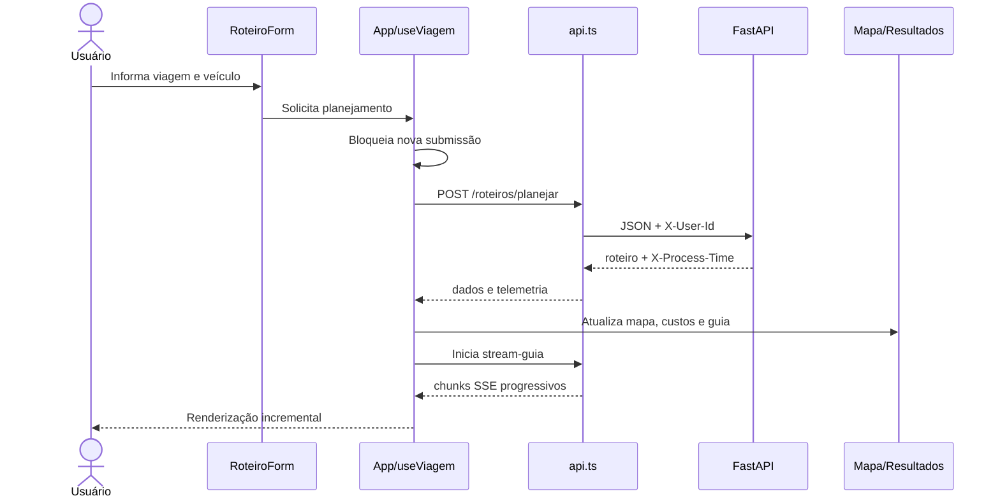

# Arquitetura do frontend

> **Estado:** conteúdo de **Fonte**, **Derivado** e **Decisão aprovada**. TypeScript e Vite+ foram aprovados em [ADR-001](./decisoes/ADR-001-typescript-e-vite-plus.md).

## Objetivo arquitetural

A interface será uma SPA independente em React 19, escrita em TypeScript e construída com Vite+ sobre o servidor/build do Vite. Em desenvolvimento será executada na porta `5173`. Ela concentra apresentação e estado de interação; regras persistentes, integrações externas e decisões de negócio permanecem no backend.

Fonte: [Estrutura do Frontend React 19](../modulo-guia-turista-inteligente.md#22-frontend-react-19).

## Organização prevista

```text
app/frontend/
├── public/                 # favicon, sprite de ícones e manifesto PWA
├── src/
│   ├── assets/             # imagens e ilustrações
│   ├── components/         # componentes visuais e limites de erro
│   ├── hooks/              # estado e efeitos reutilizáveis
│   ├── services/           # API, SSE, geolocalização e storage local
│   ├── types/              # validação defensiva dos dados recebidos
│   ├── App.tsx             # composição e orquestração da interface
│   ├── config.ts           # URL da API e Google Client ID
│   ├── index.css           # tokens, temas e responsividade
│   └── main.tsx            # ponto de montagem
├── index.html
├── package.json
├── tsconfig.json
└── vite.config.ts
```

## Responsabilidades por camada

| Camada | Responsabilidade | Estado |
| --- | --- | --- |
| `components/` | Renderizar formulário, mapa, resultados, telemetria, histórico, controles e feedback | Fonte |
| `hooks/` | Encapsular autenticação, tema, notificações, rede, temporizador e viagem ativa | Fonte |
| `services/api.ts` | Encapsular REST, `X-User-Id`, telemetria de resposta e leitura tipada de SSE | Decisão aprovada sobre responsabilidade da fonte |
| `services/geolocation.ts` | Obter GPS e calcular distância por Haversine | Decisão aprovada sobre responsabilidade da fonte |
| `services/visitanteStorage.ts` | Preservar sessão temporária e identidade Google recuperável | Decisão aprovada sobre responsabilidade da fonte |
| `types/schemas.ts` | Definir tipos e validar em runtime os dados recebidos | Decisão aprovada sobre responsabilidade da fonte |
| Estado global | Permanecer em `App.tsx`/`useViagem` até existir evidência para biblioteca externa | Derivado |

## Fluxo principal



## Estado e consistência

- **Fonte:** `useViagem` reúne planejamento, telemetria, custos e histórico.
- **Fonte:** `MapaRota` unifica rota, paradas, custos e altimetria como fonte única de verdade visual.
- **Derivado:** toda troca de rota ativa deve recalcular ou substituir atomicamente as métricas dependentes, evitando valores de rotas diferentes na mesma tela.
- **Derivado:** respostas antigas devem ser ignoradas quando uma solicitação mais recente assumir o estado ativo.
- **Proposto:** usar `AbortController` para cancelar `fetch` e streaming ao trocar de planejamento ou desmontar a tela.

## Comunicação

- Base da API configurada por variável de ambiente.
- REST por `fetch` para comandos e consultas.
- SSE lido com `ReadableStream` para a geração incremental do guia.
- `X-User-Id` identifica o escopo do histórico.
- `X-Process-Time` e Correlation-ID alimentam telemetria.

## Resiliência na interface

- `ErrorBoundary` contém falhas de renderização.
- `Toast` informa sucesso, erro e eventos relevantes de forma acessível.
- `useNetworkStatus` sinaliza conectividade.
- O botão de planejamento fica indisponível durante solicitação ativa.
- **Proposto:** distinguir erro recuperável, validação e indisponibilidade externa nas mensagens, sem expor detalhes internos.

## Toolchain

- `vp dev`: servidor de desenvolvimento Vite.
- `vp check`: formatação, lint e verificação de tipos.
- `vp test`: testes Vitest.
- `vp build`: build Vite de produção.
- scripts npm equivalentes permanecem no `package.json` para compatibilidade com a atividade e CI.
- TypeScript deve usar modo estrito; respostas HTTP continuam exigindo validação em runtime.

## Questões em aberto

1. O formato completo dos objetos retornados pela API ainda não está especificado.
2. Não há política definida de repetição automática, timeout ou backoff no cliente.
3. Não está definido se o manifesto PWA implicará suporte offline real.
4. O navegador e as versões mínimas suportadas precisam ser aprovados.

