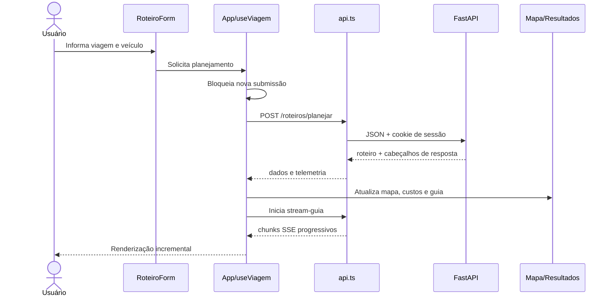

# Arquitetura do frontend

> **Estado:** conteúdo de **Fonte**, **Derivado** e **Decisão aprovada**. TypeScript e Vite+ foram aprovados em [ADR-001](./decisoes/ADR-001-typescript-e-vite-plus.md).

> **Implementação atual:** a SPA existente está em `app/frontend` e consome a API
> JSON de `app/backend`. Esta página descreve a arquitetura de referência completa;
> recursos mencionados nela que não existiam no monólito continuam fora do recorte
> de migração documentado em `specs/`.

## Objetivo arquitetural

A interface será uma SPA independente em React 19, escrita em TypeScript e construída com Vite+ sobre o servidor/build do Vite. Em desenvolvimento será executada na porta `5173`. Ela concentra apresentação e estado de interação; regras persistentes, integrações externas e decisões de negócio permanecem no backend.

Fonte: [Estrutura do Frontend React 19](../modulo-guia-turista-inteligente.md#22-frontend-react-19).

## Estrutura de referência

A fonte apresenta o frontend em `guia-turista-inteligente/completo/frontend/`. No monorepositório adotado pelo projeto, essa raiz corresponde a `app/frontend/`. A estrutura abaixo preserva os módulos e responsabilidades da fonte, adaptando os arquivos JavaScript/JSX para TypeScript/TSX conforme a [ADR-001](./decisoes/ADR-001-typescript-e-vite-plus.md).

```text
app/frontend/
├── public/
│   ├── favicon.svg                   # Favicon temático
│   ├── icons.svg                     # Sprite de ícones da interface
│   └── manifest.webmanifest          # Metadados da aplicação web
├── src/
│   ├── assets/                       # Ilustrações e imagens do portal
│   ├── components/
│   │   ├── Header.tsx                # Tema, Google Sign-In e sessão híbrida
│   │   ├── RoteiroForm.tsx           # Veículo, sugestões de destino e perfis
│   │   ├── MapaRota.tsx              # Leaflet, rota, paradas, custos e altimetria
│   │   ├── RoteiroResult.tsx         # Clima, guia via IA e atrativos
│   │   ├── TelemetriaCard.tsx        # Latência, Correlation-ID e métricas
│   │   ├── HistoricoViagens.tsx      # Histórico reativo e exclusão de viagens
│   │   ├── BotoesControleViagem.tsx  # Maps, WhatsApp e exportação GPX
│   │   ├── ErrorBoundary.tsx         # Contenção de erros de interface
│   │   ├── Toast.tsx                 # Notificações acessíveis
│   │   └── Footer.tsx                # Rodapé semântico e créditos
│   ├── hooks/
│   │   ├── useAuth.ts                # Identidade Google e visitante
│   │   ├── useTheme.ts               # Alternância e persistência do tema
│   │   ├── useToasts.ts              # Notificações temporizadas
│   │   ├── useNetworkStatus.ts       # Estado online/offline
│   │   ├── useSessionTimer.ts        # Sessão visitante de duas horas
│   │   └── useViagem.ts              # Planejamento, telemetria, custos e histórico
│   ├── services/
│   │   ├── api.ts                    # REST, X-User-Id e leitura de SSE
│   │   ├── geolocation.ts            # GPS do navegador e cálculo de Haversine
│   │   └── visitanteStorage.ts       # Cache local da sessão visitante
│   ├── types/
│   │   └── schemas.ts                # Contratos e validação em runtime
│   ├── App.tsx                       # Orquestração do layout e componentes
│   ├── index.css                     # Design tokens, tema e acessibilidade
│   ├── config.ts                     # URL da API e Google Client ID
│   ├── setupTests.ts                 # Inicialização dos testes Vitest
│   └── main.tsx                      # Montagem da aplicação React
├── index.html                        # HTML semântico, Google Identity e CSS Leaflet
├── package.json                      # React, Leaflet, Vite+ e ferramentas de teste
├── tsconfig.json                     # Configuração estrita do TypeScript
├── vite.config.ts                    # Plugins e servidor/build Vite+
└── .env.example                      # Modelo de configuração sem segredos
```

**Estado da árvore:** o workspace `app/frontend` possui uma SPA funcional com
componentes, hooks, cliente REST, tipos e estilos modulares. A tabela acima descreve
uma arquitetura de referência ampliada; recursos sem equivalente no monólito atual
permanecem fora da reorganização registrada em `specs/`. Variáveis com prefixo
`VITE_` são incorporadas ao bundle e não podem conter segredos.

## Responsabilidades por camada

| Camada | Responsabilidade | Estado |
| --- | --- | --- |
| `components/` | Renderizar formulário, mapa, resultados, telemetria, histórico, controles e feedback | Fonte |
| `hooks/` | Encapsular autenticação, tema, notificações, rede, temporizador e viagem ativa | Fonte |
| `services/api.ts` | REST por cookie de sessão; SSE permanece como referência futura | Implementado para os endpoints existentes |
| `services/geolocation.ts` | Obter GPS e calcular distância por Haversine | Decisão aprovada sobre responsabilidade da fonte |
| `services/visitanteStorage.ts` | Preservar sessão temporária e identidade Google recuperável | Decisão aprovada sobre responsabilidade da fonte |
| `types/schemas.ts` | Definir tipos e validar em runtime os dados recebidos | Decisão aprovada sobre responsabilidade da fonte |
| Estado global | Permanecer em `App.tsx`/`useViagem` até existir evidência para biblioteca externa | Derivado |

## Fluxo principal



## Estado e consistência

- **Fonte:** `useViagem` reúne planejamento, telemetria, custos e histórico.
- **Fonte:** `MapaRota` unifica rota, paradas, custos e altimetria como fonte única de verdade visual.
- **Derivado:** toda troca de rota ativa deve recalcular ou substituir atomicamente as métricas dependentes, evitando valores de rotas diferentes na mesma tela.
- **Derivado:** respostas antigas devem ser ignoradas quando uma solicitação mais recente assumir o estado ativo.
- **Proposto:** usar `AbortController` para cancelar `fetch` e streaming ao trocar de planejamento ou desmontar a tela.

## Comunicação

- Base da API configurada por variável de ambiente.
- REST por `fetch` para comandos e consultas.
- SSE e telemetria de produto aparecem como alvos futuros, sem equivalente nos
  fluxos do monólito migrados.
- O cookie de sessão assinado identifica o escopo do histórico; `X-User-Id` não é
  aceito como identidade confiável.
- `X-Process-Time` e `X-Request-ID` são cabeçalhos operacionais da API.

## Resiliência na interface

- `ErrorBoundary` contém falhas de renderização.
- `Toast` informa sucesso, erro e eventos relevantes de forma acessível.
- `useNetworkStatus` sinaliza conectividade.
- O botão de planejamento fica indisponível durante solicitação ativa.
- **Proposto:** distinguir erro recuperável, validação e indisponibilidade externa nas mensagens, sem expor detalhes internos.

## Toolchain

- `vp dev`: servidor de desenvolvimento Vite.
- `vp check`: formatação, lint e verificação de tipos.
- `vp test`: testes Vitest.
- `vp build`: build Vite de produção.
- scripts npm equivalentes permanecem no `package.json` para compatibilidade com a atividade e CI.
- TypeScript deve usar modo estrito; respostas HTTP continuam exigindo validação em runtime.

## Questões em aberto

1. O formato completo dos objetos retornados pela API ainda não está especificado.
2. Não há política definida de repetição automática, timeout ou backoff no cliente.
3. Não está definido se o manifesto PWA implicará suporte offline real.
4. O navegador e as versões mínimas suportadas precisam ser aprovados.

