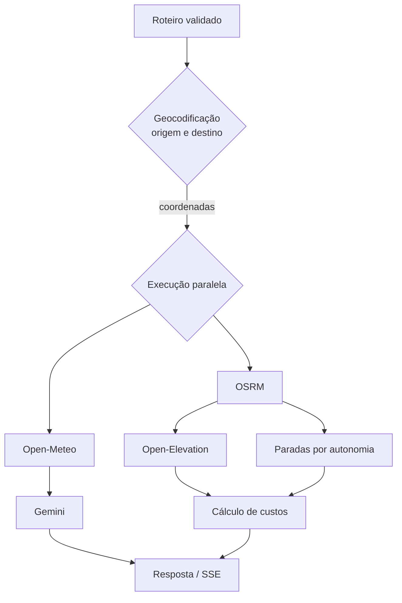

# Integrações externas

## Catálogo

**Estado:** Fonte, salvo onde indicado.  
**Rastreabilidade:** [Arquitetura de Microsserviços](../modulo-guia-turista-inteligente.md#13-arquitetura-de-microsserviços), [Mapa e Autonomia](../modulo-guia-turista-inteligente.md#33-mapa-e-autonomia) e [Guia e Streaming](../modulo-guia-turista-inteligente.md#35-guia-e-streaming).

| Integração | Finalidade | Direção | Dados principais | Proteção esperada |
| --- | --- | --- | --- | --- |
| Open-Meteo | Clima atual do destino | backend → provedor | latitude/longitude; temperatura, sensação, vento e condição | timeout, circuit breaker, fallback/cache |
| OSRM | Geometria, distância, duração e rotas alternativas | backend → provedor | coordenadas e preferência de rota | timeout, circuit breaker, cache |
| Open-Elevation | Perfil topográfico | backend → provedor | pontos da rota; elevações | timeout, circuit breaker, fallback degradado |
| Google Gemini | Guia contextual integral e streaming | backend → provedor | destino, dias, estilo, clima e catálogo | timeout, lock, cancelamento e tratamento de streaming |
| Google Identity Services | Login Google | navegador/backend → Google | token de identidade JWT | validação do token no backend |
| Leaflet | Renderização do mapa | navegador | geometria e marcadores | tratamento de falha de renderização |
| Google Maps | Abrir navegação | navegador → serviço externo | origem/destino ou rota | link seguro e codificado |
| WhatsApp | Compartilhar resumo | navegador/background → serviço externo | resumo da viagem | codificação e consentimento |
| Navegadores GPS | Consumir rota | download/compartilhamento | GPX 1.1 | XML válido |

O mecanismo de geocodificação é usado no fluxo, mas o provedor não é identificado na fonte.

## Fluxo de enriquecimento

## Política de clientes e credenciais

- **Fonte:** o backend usa `httpx.AsyncClient` compartilhado.
- **Fonte:** `GEMINI_API_KEY` e `GOOGLE_CLIENT_ID` são configuráveis por ambiente.
- **Derivado:** chamadas a provedores devem ter timeout finito e não devem propagar segredos ao front-end.
- **Proposto:** definir um adaptador por provedor para evitar contratos externos dentro dos routers.
- **Proposto:** normalizar erros de integração em uma taxonomia interna (`timeout`, `indisponível`, `resposta_inválida`, `circuito_aberto`).

## Comportamento degradado

A fonte afirma uso de circuit breakers com fallback e degradação graciosa, mas não especifica o resultado de cada falha. Antes da implementação, decidir:

| Falha | Comportamento a decidir |
| --- | --- |
| Clima indisponível | retornar roteiro sem clima, usar cache ou falhar toda a solicitação? |
| OSRM indisponível | há rota aproximada aceitável ou a solicitação é inviável? |
| Elevação indisponível | omitir perfil e penalização ou usar consumo nominal? |
| Gemini indisponível | retornar dados estruturados sem guia, usar catálogo local ou falhar? |
| Geocodificação ambígua | solicitar desambiguação ou escolher primeiro resultado? |

## Dados e privacidade

- Enviar a provedores apenas os dados necessários ao cálculo.
- Não enviar identificador de usuário ao provedor de IA sem necessidade explícita.
- Não registrar tokens Google ou `GEMINI_API_KEY`.
- Definir se o conteúdo compartilhado pode incluir nome, localização ou histórico; esta política não aparece na fonte.

## Critérios técnicos propostos

Estes limites precisam de validação e não são requisitos confirmados:

- timeout individual por provedor menor que o timeout total do endpoint;
- retentativas somente para operações idempotentes, com backoff e jitter;
- cache apenas para respostas compatíveis com a validade do dado;
- métricas por provedor: latência, sucesso, erro, timeout e circuito aberto;
- validação defensiva do formato retornado antes de alimentar cálculos ou IA.

