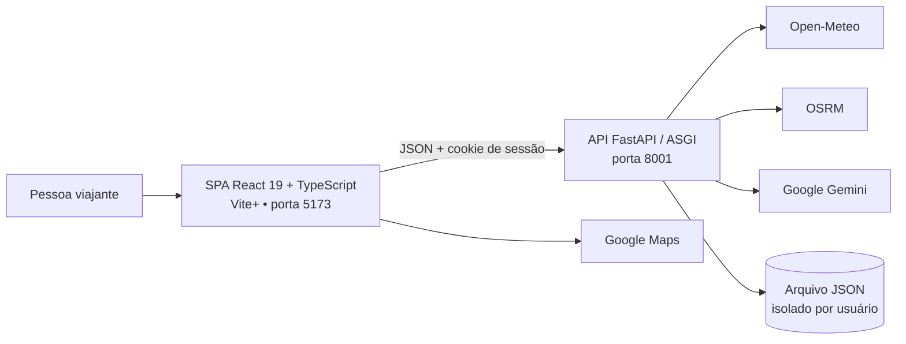
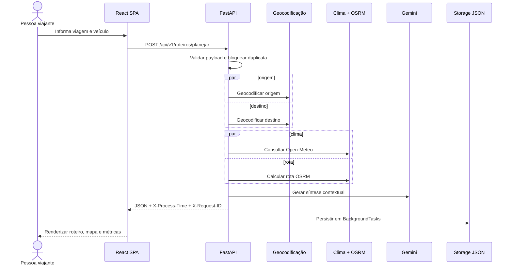

# Visão geral da arquitetura

## Objetivo

Esta arquitetura moderniza o Guia do Turista Inteligente, separando a interface React 19 + TypeScript, construída com Vite+, da API FastAPI e isolando integrações externas em serviços assíncronos. O objetivo é permitir evolução independente, contratos explícitos e execução concorrente de operações de rede.

**Estado:** Fonte, com organização derivada para orientar a implementação.  
**Rastreabilidade:** [Visão Geral](../modulo-guia-turista-inteligente.md#1-visão-geral), [Arquitetura de Microsserviços](../modulo-guia-turista-inteligente.md#13-arquitetura-de-microsserviços) e [Estrutura dos Projetos](../modulo-guia-turista-inteligente.md#2-estrutura-dos-projetos).

**Runtime migrado:** React em `app/frontend` consome JSON da API FastAPI em
`app/backend` com cookie de sessão assinado. A tabela e os diagramas abaixo também
registram alvos globais futuros; mapa dedicado, SSE, altimetria, custos, GPX,
compartilhamento e métricas não fazem parte da migração atual.

## Contexto do sistema

## Contêineres

| Contêiner | Responsabilidade | Tecnologia | Estado |
| --- | --- | --- | --- |
| Front-end SPA | Coletar parâmetros, gerir sessão e estado, exibir mapa, guia, custos, histórico e telemetria | React 19, TypeScript, Vite+, Leaflet, Fetch API | Fonte + decisão aprovada |
| Backend API | Validar contratos, orquestrar serviços, aplicar regras, persistir viagens e expor telemetria | FastAPI, ASGI/Uvicorn, Pydantic v2, httpx | Fonte |
| Armazenamento | Guardar viagens por usuário com escrita atômica e file lock | Arquivo JSON | Fonte |
| Provedores | Fornecer clima, roteamento, elevação e conteúdo gerado | Open-Meteo, OSRM, Open-Elevation, Gemini | Fonte |

Backend e frontend são aplicações independentes dentro de um único monorepo Turborepo. A separação é arquitetural e de implantação, não de repositório Git. Consulte [ADR-002](./decisoes/ADR-002-monorepo-com-turborepo.md).

## Princípios arquiteturais

1. **Separação cliente-servidor — Fonte + decisão aprovada:** front-end e backend são aplicações independentes dentro do mesmo monorepo.
2. **Contratos antes da implementação — Fonte:** Pydantic v2 valida entradas; OpenAPI 3.1 publica contratos em `/docs` e `/redoc`.
3. **I/O não bloqueante — Fonte:** integrações externas usam `httpx.AsyncClient` compartilhado e `asyncio.gather()`.
4. **Degradação controlada — Fonte:** cache, circuit breakers e fallbacks reduzem o impacto de provedores indisponíveis.
5. **Identidade explícita — Implementação:** cookie de sessão assinado isola histórico e operações por usuário; `X-User-Id` não autentica chamadas.
6. **Observabilidade operacional — Implementação:** `X-Process-Time`, `X-Request-ID` e probes; métricas Prometheus permanecem como alvo futuro.
7. **Fonte única de estado na interface — Fonte + decisão aprovada:** `App.tsx` e hooks coordenam formulário, mapa, resultados e histórico.

## Fluxo principal de planejamento

O diagrama mostra a ordem lógica descrita na fonte. O mecanismo exato de geocodificação não é nomeado e permanece uma questão em aberto.

## Limites e dependências

- O navegador acessa somente a API do projeto; credenciais de provedores devem ficar no backend.
- O backend aceita origens CORS de desenvolvimento nas portas `5173` e `3000`.
- A API depende da rede para enriquecer o roteiro, mas deve usar circuit breakers e fallbacks quando disponíveis.
- O armazenamento JSON é adequado ao escopo didático; sua evolução para banco de dados é uma decisão futura, não um requisito da fonte.

## Questões em aberto

- Qual serviço realiza a geocodificação de cidades?
- Quais dados podem ser retornados parcialmente quando um provedor falha?
- Qual é o modelo de implantação além do ambiente local?
- Qual é a política de retenção e proteção dos históricos de viagem?
- A expressão “microsserviços” representa processos implantáveis separados ou módulos de serviço dentro de uma única API? A fonte descreve um único backend FastAPI.

