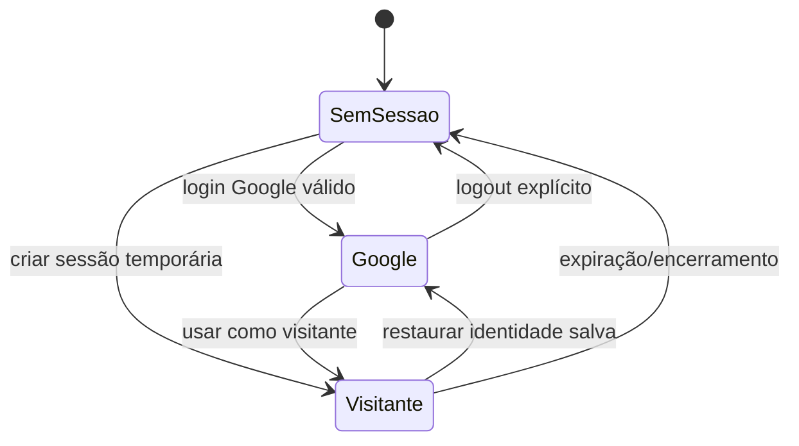

# Sessões, temas e acessibilidade

> **Estado:** sessão híbrida e WCAG são de **Fonte**; detalhes operacionais adicionais estão marcados.

## Sessão híbrida

O produto admite identidade Google e visitante temporário. Alternar para visitante não encerra nem apaga a identidade Google previamente conectada.

### Regras documentadas

- Sessão visitante possui TTL de 2 horas.
- A identidade Google preservada usa a chave `guia_turista_saved_google_user` no `localStorage`.
- O cabeçalho oferece restauração em um clique.
- O encerramento do visitante pode usar `sendBeacon` ao fechar a janela.
- Histórico e chamadas usam a identidade ativa, não apenas a identidade preservada.

### Cuidados derivados

- Não armazenar token Google bruto em storage persistente sem decisão explícita de segurança.
- Trocar de identidade deve limpar da tela dados pertencentes à sessão anterior.
- Expiração precisa ser anunciada e levar a estado seguro.
- Falhas no `localStorage` não podem impedir o uso básico da aplicação.

## Tema

- Oferecer temas claro e escuro via `useTheme` e atributo `data-theme`.
- Persistir a preferência do usuário.
- Manter contraste e estados de foco em ambos os temas.
- **Proposto:** respeitar `prefers-color-scheme` na primeira visita.

## Acessibilidade

A meta registrada é WCAG 2.1 AA. Na implementação:

- utilizar landmarks semânticos (`header`, `main`, `aside`, `footer`);
- manter ordem lógica de foco e operação completa por teclado;
- associar rótulos, instruções e erros aos campos;
- anunciar carregamento, conclusão, falhas e chunks relevantes sem excesso;
- oferecer nome acessível para ícones e botões;
- não depender somente de cor para estado;
- manter contraste AA e foco visível;
- fornecer alternativa textual para mapa, perfil altimétrico e métricas gráficas;
- respeitar redução de movimento;
- preservar zoom e responsividade em dispositivos móveis.

## Privacidade e consentimento

- Geolocalização só deve ser solicitada após ação/contexto compreensível.
- Negar GPS não pode bloquear planejamento manual.
- Compartilhamento deve mostrar o destino/canal antes do envio.
- **Questão em aberto:** política de retenção do histórico e dados de identidade.
- **Questão em aberto:** base legal, aviso de privacidade e mecanismo de exclusão total dos dados.

Fonte: [Sessão Híbrida](../modulo-guia-turista-inteligente.md#36-sessao-hibrida) e [responsabilidades do frontend](../modulo-guia-turista-inteligente.md#responsabilidade-dos-modulos-do-front-end).

