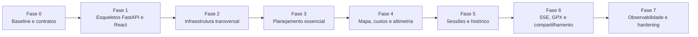

# Roadmap de evolução técnica

## Objetivo

Evoluir a implementação Flask/SSR atual para dois projetos independentes: backend FastAPI/ASGI e frontend React 19 + TypeScript + Vite+, preservando a equivalência funcional descrita na [fonte canônica](../modulo-guia-turista-inteligente.md).

Este roadmap organiza dependências de entrega; não representa estimativas de calendário.

## Estado da reorganização atual

O recorte de migração solicitado está implementado: a interface React em
`app/frontend` consome a API FastAPI em `app/backend`, e os fluxos que existiam no
monólito foram migrados sem habilitar recursos descritos apenas como alvos futuros.
O SSR Flask e seus arquivos de apresentação foram aposentados. As fases abaixo que
descrevem mapa dedicado, custos, SSE, GPX, compartilhamento, catálogo e telemetria
continuam sendo referências futuras, fora do escopo desta migração.

## Baseline do monólito e arquitetura-alvo

| Área | Comportamento de origem | Destino documentado |
| --- | --- | --- |
| Aplicação web | Flask com Jinja2 em `app.py` e `templates/` | SPA React 19 + TypeScript + Vite+ independente |
| Integrações | Chamadas síncronas com `httpx.Client` em `services.py` | Serviços assíncronos com `httpx.AsyncClient` compartilhado |
| IA | Gemini com fallback em `planejamento.py` | Geração normal e streaming SSE no backend |
| Persistência | JSON e memória de visitante controlados pelo monólito | Serviço de persistência isolado, atômico e executado em background |
| Concorrência | Locks de thread no processo Flask | `asyncio.Lock`, cancelamento ativo e orquestração com `asyncio.gather` |
| Testes | Suíte pytest do monólito | Pytest no backend e Vitest/Testing Library no frontend |

## Sequência de implementação

### Fase 0 — Baseline e contratos

- Congelar o comportamento atual com testes de caracterização.
- Aprovar requisitos, regras de negócio, contratos HTTP e critérios de aceite.
- Resolver as questões em aberto marcadas na documentação.
- Definir a estratégia de coexistência ou substituição do monólito.

**Saída:** documentação versionada e baseline reproduzível.

### Fase 1 — Esqueletos desacoplados

- Consolidar a raiz npm workspace e o pipeline Turborepo.
- Criar `app/backend/` com FastAPI, configuração, `lifespan`, routers e schemas.
- Criar `app/frontend/` com React 19, TypeScript estrito, Vite+ e estrutura de componentes, hooks e serviços.
- Configurar scripts npm compatíveis para `vp dev`, `vp check`, `vp test` e `vp build`.
- Adicionar adaptador de tarefas npm no backend para orquestrar Uvicorn, Ruff, Mypy e pytest pelo Turbo.
- Configurar CORS para origens de desenvolvimento autorizadas.
- Disponibilizar `/healthz`, `/readyz`, Swagger UI e ReDoc.

**Dependência:** Fase 0 concluída.

### Fase 2 — Infraestrutura transversal

- Implantar `httpx.AsyncClient` compartilhado e injeção de dependências.
- Adicionar configuração por ambiente, logs estruturados e `X-Request-ID`.
- Criar cache com TTL e circuit breakers por provedor.
- Definir tratamento uniforme de erros e timeouts.

**Saída:** base resiliente para as integrações.

### Fase 3 — Planejamento essencial

- Migrar geocodificação, clima, rota OSRM e catálogo curado.
- Implementar contratos Pydantic v2 e validações de cidade/UF.
- Orquestrar geocodificação, clima e rota com concorrência controlada.
- Entregar `POST /api/v1/roteiros/planejar` e o cliente REST do frontend.

**Saída:** planejamento básico ponta a ponta, ainda sem todos os recursos avançados.

### Fase 4 — Mapa, autonomia, custos e altimetria

- Implementar geometria e alternativas de rota.
- Integrar Open-Elevation e calcular perfil, ganho e perda de elevação.
- Calcular autonomia, paradas, combustível/energia, pedágios, emissões e rateio.
- Renderizar Leaflet, seletor de alternativas, topografia e painel de custos.

**Saída:** experiência completa de rota rodoviária.

### Fase 5 — Identidade, sessão e histórico

- Implementar login Google e visitante temporário.
- Preservar e restaurar a sessão Google durante o modo visitante.
- Isolar histórico por usuário e executar persistência em segundo plano.
- Implementar listagem, exclusão e marcação de atrativos visitados.

**Saída:** jornadas autenticada e anônima consistentes.

### Fase 6 — Guia, streaming e exportação

- Implementar geração de guia conciso e streaming SSE.
- Cancelar processamento quando o cliente desconectar.
- Implementar exportação GPX 1.1 e ações Google Maps/WhatsApp.
- Adicionar compartilhamento em background.

**Saída:** recursos de IA e portabilidade de roteiro completos.

### Fase 7 — Observabilidade, desempenho e hardening

- Expor métricas Prometheus e painel de telemetria.
- Validar meta de latência definida nos requisitos não funcionais.
- Executar testes de concorrência, contrato, componentes e acessibilidade.
- Exercitar falhas dos provedores e validar degradação graciosa.
- Revisar segurança, dados sensíveis e limites operacionais.

**Saída:** candidato a entrega validado pelos critérios de aceite.

## Política de migração

1. Não remover o monólito antes de existir cobertura de caracterização equivalente.
2. Migrar uma capacidade vertical por vez, incluindo contrato, backend, frontend e teste.
3. Não acoplar componentes React diretamente ao formato bruto de provedores externos.
4. Manter segredos fora do repositório e usar somente arquivos `.env.example` versionados.
5. Toda mudança de escopo deve atualizar requisitos, critérios de aceite e matriz de rastreabilidade.

## Definition of Done global

Uma capacidade só está concluída quando:

- o requisito e as regras associadas estão identificados;
- o contrato público está documentado;
- caminhos de sucesso, validação e falha têm testes automatizados;
- logs não expõem tokens ou dados sensíveis;
- estados de carregamento, vazio e erro existem no frontend;
- acessibilidade por teclado e feedback ao usuário foram verificados;
- a matriz de rastreabilidade aponta para evidência executável.

