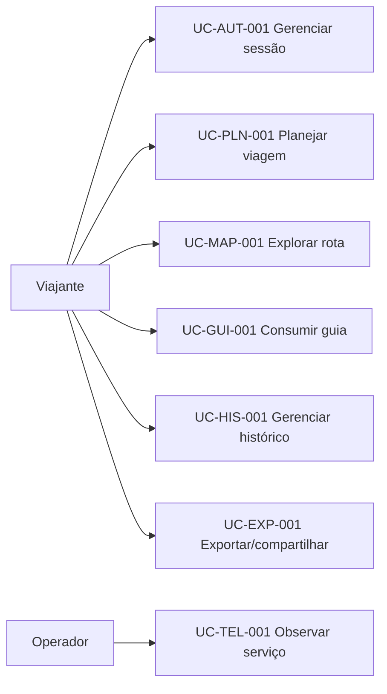

# Casos de uso

Os casos de uso organizam os requisitos por objetivo do ator. Eles não substituem os contratos da API nem os critérios de aceite detalhados.

## Mapa de casos de uso

## UC-AUT-001 — Iniciar e alternar sessão

- **Ator principal:** viajante.
- **Objetivo:** usar o produto autenticado pelo Google ou como visitante temporário.
- **Pré-condições:** aplicação carregada; Google disponível apenas para o fluxo autenticado.
- **Fluxo principal:**
  1. O viajante escolhe entrar pelo Google ou continuar como visitante.
  2. O sistema valida o token Google ou cria identidade temporária com TTL de duas horas.
  3. O cabeçalho apresenta a identidade e o estado da sessão.
  4. Ao alternar para visitante, a identidade Google anterior permanece preservada.
  5. O viajante pode restaurar a identidade Google preservada.
- **Alternativas:** token Google inválido é recusado; sessão visitante expirada exige renovação ou autenticação.
- **Pós-condições:** existe exatamente uma identidade ativa para contextualizar as chamadas.
- **Requisitos:** RF-AUT-001 a RF-AUT-006; RN-AUT-001 a RN-AUT-005.
- **Estado:** Fonte, com autorização do cabeçalho ainda proposta.

## UC-PLN-001 — Planejar uma viagem

- **Ator principal:** viajante.
- **Objetivo:** obter um plano consolidado para uma viagem rodoviária.
- **Pré-condições:** identidade ativa; formulário disponível.
- **Fluxo principal:**
  1. O viajante informa origem/UF, destino/UF, duração, perfil e dados do veículo.
  2. O frontend valida campos básicos, desabilita nova submissão e envia a solicitação.
  3. O backend valida o contrato e reserva a chave de idempotência.
  4. O backend geocodifica origem/destino em paralelo.
  5. O backend consulta clima e rota em paralelo e compõe dados adicionais.
  6. O frontend apresenta resultados, mapa, custos e telemetria.
  7. O backend agenda a persistência se o cliente continuar conectado.
- **Alternativas:** entrada inválida gera 422; duplicidade ativa gera 409; desconexão cancela o pipeline; provedor pode acionar circuito/fallback.
- **Pós-condições:** resposta apresentada e, quando elegível, roteiro salvo no histórico.
- **Requisitos:** RF-PLN-001 a RF-PLN-007; RF-MAP-001; RF-CST-001; RF-GUI-001; RF-HIS-001.
- **Estado:** Fonte/Derivado.

## UC-PLN-002 — Obter sugestões por localização

- **Ator principal:** viajante.
- **Objetivo:** escolher rapidamente um destino turístico a partir da posição atual.
- **Pré-condições:** navegador oferece geolocalização e usuário concede permissão.
- **Fluxo principal:** o frontend obtém coordenadas, calcula distâncias por Haversine e apresenta quatro sugestões elegíveis; o viajante seleciona uma delas para preencher o destino.
- **Alternativas:** permissão negada ou localização indisponível mantém preenchimento manual.
- **Requisitos:** RF-PLN-004.
- **Questão em aberto:** semântica exata do limiar de 400 km.

## UC-MAP-001 — Explorar rota, relevo e autonomia

- **Ator principal:** viajante.
- **Objetivo:** avaliar percurso e viabilidade do veículo.
- **Pré-condições:** planejamento com rota calculada.
- **Fluxo principal:**
  1. O mapa renderiza origem, destino, geometria e paradas.
  2. O viajante alterna entre rota principal e alternativa disponível.
  3. O sistema atualiza distância, duração, pedágios, consumo e custos.
  4. O viajante expande o perfil altimétrico.
  5. O sistema mostra elevação e influência no consumo.
- **Alternativas:** sem alternativa, apenas a rota principal é exibida; indisponibilidade de elevação deve seguir modo degradado ainda a definir.
- **Requisitos:** RF-MAP-001 a RF-MAP-005; RF-CST-001 a RF-CST-004.
- **Estado:** Fonte/Derivado.

## UC-GUI-001 — Acompanhar guia turístico em streaming

- **Ator principal:** viajante.
- **Objetivo:** receber rapidamente recomendações contextualizadas.
- **Pré-condições:** destino e contexto de viagem disponíveis.
- **Fluxo principal:** o frontend inicia `/stream-guia`; o backend gera fragmentos; cada evento é anexado ao conteúdo; o evento `done: true` encerra o carregamento.
- **Alternativas:** desconexão interrompe a geração; erro produz evento terminal com descrição controlada.
- **Pós-condições:** guia conciso disponível na tela.
- **Requisitos:** RF-GUI-002 a RF-GUI-004; RN-GUI-001 a RN-GUI-007.
- **Estado:** Fonte.

## UC-GUI-002 — Registrar atração visitada

- **Ator principal:** viajante.
- **Objetivo:** acompanhar atrações já visitadas em um roteiro salvo.
- **Pré-condições:** roteiro identificado e pertencente ao usuário ativo.
- **Fluxo principal:** o viajante altera a marcação; o frontend envia `PATCH`; o backend persiste a alteração; a interface confirma o novo estado.
- **Alternativas:** roteiro ausente ou não autorizado não deve ser alterado.
- **Requisitos:** RF-GUI-005 e RF-GUI-006; RN-AUT-004.
- **Estado:** Fonte/Derivado.

## UC-HIS-001 — Consultar e excluir histórico

- **Ator principal:** viajante.
- **Objetivo:** rever ou remover viagens anteriores.
- **Pré-condições:** identidade ativa.
- **Fluxo principal:** o frontend lista viagens do usuário; o viajante escolhe excluir; o backend remove o registro; a lista é atualizada sem recarga total.
- **Alternativas:** histórico vazio mostra estado apropriado; exclusão inexistente ou de outro usuário é recusada.
- **Requisitos:** RF-HIS-002 e RF-HIS-003; RN-HIS-003 e RN-HIS-004.
- **Estado:** Fonte/Derivado.

## UC-EXP-001 — Exportar ou compartilhar viagem

- **Ator principal:** viajante.
- **Objetivo:** levar a rota a outros aplicativos ou pessoas.
- **Pré-condições:** roteiro calculado.
- **Fluxos possíveis:** abrir a rota no Google Maps; preparar compartilhamento pelo WhatsApp; baixar GPX 1.1; solicitar despacho em background por canal previsto.
- **Alternativas:** aplicativo externo indisponível ou falha no despacho deve gerar feedback sem perder o roteiro.
- **Requisitos:** RF-EXP-001 a RF-EXP-004.
- **Estado:** Fonte; detalhes de canais e destinatários permanecem em aberto.

## UC-TEL-001 — Diagnosticar a operação

- **Ator principal:** operador/desenvolvedor.
- **Objetivo:** verificar disponibilidade, desempenho e falhas.
- **Pré-condições:** backend em execução.
- **Fluxo principal:** consultar saúde/prontidão; coletar `/metrics`; correlacionar uma chamada por `X-Request-ID`; comparar `X-Process-Time` com tempo do frontend; inspecionar estado dos provedores/circuitos.
- **Requisitos:** RF-TEL-001 a RF-TEL-005; RNF-TEL-001 a RNF-TEL-005.
- **Estado:** Fonte/Derivado.

## Referências na fonte

- [3. Telas e Componentes](../modulo-guia-turista-inteligente.md#3-telas-e-componentes)
- [4. Engenharia Assíncrona](../modulo-guia-turista-inteligente.md#4-engenharia-assíncrona)
- [5. Instalação e Execução](../modulo-guia-turista-inteligente.md#5-instalação-e-execução)

