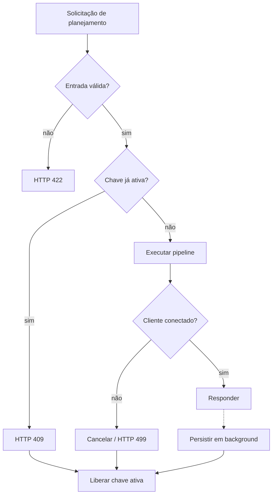

# Regras de negócio

As regras descrevem decisões do domínio que permanecem verdadeiras independentemente da tela ou tecnologia. Quando a fonte apenas sugere uma regra, ela aparece como **Derivado**; regras necessárias, mas ausentes, são marcadas como **Proposto**.

## Sessões e identidade

| ID | Regra | Estado |
| --- | --- | --- |
| RN-AUT-001 | Uma sessão visitante tem duração máxima de duas horas. | Fonte |
| RN-AUT-002 | Alternar para visitante não encerra nem apaga a identidade Google previamente conectada. | Fonte |
| RN-AUT-003 | A identidade Google preservada deve poder ser restaurada sem nova autenticação enquanto continuar válida. | Fonte |
| RN-AUT-004 | Histórico, alterações e exclusões são sempre resolvidos no contexto do usuário ativo. | Fonte |
| RN-AUT-005 | Uma identidade enviada pelo cliente só deve autorizar dados após validação confiável no servidor. | Proposto |

Referência: [Sessão Híbrida](../modulo-guia-turista-inteligente.md#36-sessão-híbrida) e [Histórico e Persistência](../modulo-guia-turista-inteligente.md#34-histórico-e-persistência).

## Entrada e planejamento

| ID | Regra | Estado |
| --- | --- | --- |
| RN-PLN-001 | UF de origem e destino deve conter exatamente duas letras maiúsculas e representar valor aceito pelo catálogo. | Fonte |
| RN-PLN-002 | Cidade deve passar por sanitização antes do uso em integrações e chaves de idempotência. | Fonte |
| RN-PLN-003 | O planejamento deve considerar origem, destino, dias de estadia e estilo de viagem. | Fonte |
| RN-PLN-004 | A chave de uma solicitação ativa combina usuário, cidade/UF de origem e cidade/UF de destino, normalizados. | Fonte |
| RN-PLN-005 | Uma segunda solicitação com a mesma chave, enquanto a primeira estiver ativa, deve receber HTTP 409. | Fonte |
| RN-PLN-006 | A chave ativa deve ser removida ao final, com sucesso ou erro. | Fonte |
| RN-PLN-007 | O limiar de `400 km` das recomendações precisa ser interpretado antes da implementação definitiva. | Questão em aberto |

Referência: [Planejador de Viagens](../modulo-guia-turista-inteligente.md#31-planejador-de-viagens) e [Idempotência e Bloqueios](../modulo-guia-turista-inteligente.md#43-idempotência-e-bloqueios).

## Rota, autonomia e custos

| ID | Regra | Estado |
| --- | --- | --- |
| RN-MAP-001 | Métricas apresentadas devem corresponder à rota atualmente selecionada. | Derivado |
| RN-MAP-002 | Ao trocar entre rota principal e alternativa, tempo e consumo devem ser recalculados. | Fonte |
| RN-MAP-003 | Ganho e perda de elevação devem influenciar a estimativa de consumo. | Fonte |
| RN-CST-001 | Paradas devem ser posicionadas antes de o tanque ou bateria atingir a reserva crítica. | Fonte |
| RN-CST-002 | O cálculo de paradas utiliza margem de segurança aproximada de 18%. | Fonte |
| RN-CST-003 | O custo total é composto pelo gasto estimado de combustível/energia e pedágios aplicáveis. | Fonte |
| RN-CST-004 | O rateio divide o custo total pela quantidade informada, limitada a oito passageiros. | Fonte |
| RN-CST-005 | Parâmetros e fórmulas de preço, pedágio, emissão e penalização altimétrica devem ser versionados e documentados. | Proposto |

Referência: [Mapa e Autonomia](../modulo-guia-turista-inteligente.md#33-mapa-e-autonomia).

## Guia e conteúdo

| ID | Regra | Estado |
| --- | --- | --- |
| RN-GUI-001 | O guia deve usar dados reais disponíveis de clima e o perfil selecionado como contexto. | Fonte |
| RN-GUI-002 | A identidade/atmosfera local ocupa uma frase direta de até 20 palavras. | Fonte |
| RN-GUI-003 | Cada turno ou dia do roteiro contém exatamente uma frase de ação, com até 15 palavras. | Fonte |
| RN-GUI-004 | Gastronomia é resumida em uma frase com dois ou três sabores/pratos e indicação de onde experimentá-los. | Fonte |
| RN-GUI-005 | Orientações práticas e clima ocupam uma frase funcional associada a vestuário e horários. | Fonte |
| RN-GUI-006 | O streaming encerra com evento explícito `done: true`. | Fonte |
| RN-GUI-007 | Fragmentos já exibidos não devem ser apagados ao receber o próximo evento. | Fonte |

Referência: [Diretriz de Síntese](../modulo-guia-turista-inteligente.md#diretriz-de-síntese-e-concisão-do-roteiro-gemini-ai) e [Streaming com SSE](../modulo-guia-turista-inteligente.md#42-streaming-com-sse).

## Histórico, cancelamento e tarefas em segundo plano

| ID | Regra | Estado |
| --- | --- | --- |
| RN-HIS-001 | Um roteiro só pode ser agendado para persistência se o cliente ainda estiver conectado ao concluir a resposta. | Fonte |
| RN-HIS-002 | Persistir um roteiro não deve bloquear a entrega do JSON principal. | Fonte |
| RN-HIS-003 | Cada usuário acessa apenas seu próprio conjunto de viagens. | Fonte |
| RN-HIS-004 | Excluir uma viagem deve removê-la da interface após confirmação bem-sucedida do backend. | Derivado |
| RN-EXP-001 | Compartilhamentos que não influenciam a resposta imediata devem ser despachados em segundo plano. | Fonte |
| RN-EXP-002 | Quando destinatário não for informado, a fonte exemplifica `contato@guiadoturista.com.br`; o uso real desse padrão exige validação do produto. | Questão em aberto |

Referência: [Histórico e Persistência](../modulo-guia-turista-inteligente.md#34-histórico-e-persistência), [Detecção de Desconexão](../modulo-guia-turista-inteligente.md#44-detecção-de-desconexão) e [Tarefas em Segundo Plano](../modulo-guia-turista-inteligente.md#45-tarefas-em-segundo-plano).

## Falhas e degradação

| ID | Regra | Estado |
| --- | --- | --- |
| RN-DES-001 | Desconexão detectada antes da conclusão interrompe o pipeline e impede persistência incompleta. | Fonte |
| RN-DES-002 | A fonte usa o código HTTP 499 para representar cancelamento pelo cliente. | Fonte |
| RN-DES-003 | Falha durante SSE deve produzir um último evento de erro marcado como concluído. | Fonte |
| RN-DES-004 | Provedor com circuito aberto deve falhar rapidamente e usar degradação prevista, quando houver. | Fonte |
| RN-DES-005 | O conjunto mínimo de dados para cada modo degradado deve ser definido antes da implementação. | Proposto |

Referência: [Engenharia Assíncrona](../modulo-guia-turista-inteligente.md#4-engenharia-assíncrona) e [Backend FastAPI](../modulo-guia-turista-inteligente.md#21-backend-fastapi).

## Invariantes

## Questões em aberto

- A fonte não define todos os limites numéricos dos modelos Pydantic.
- Não está definido como arredondar valores monetários, distâncias, consumo e cotas.
- Falta definir comportamento quando um trecho é maior que a autonomia mesmo com paradas conhecidas.
- Falta definir se uma marcação de atração visitada pode ocorrer em roteiro de outro modo de sessão após alternância.
- HTTP 499 não é um código padronizado pela IANA; sua adoção deve ser confirmada para clientes e observabilidade.

