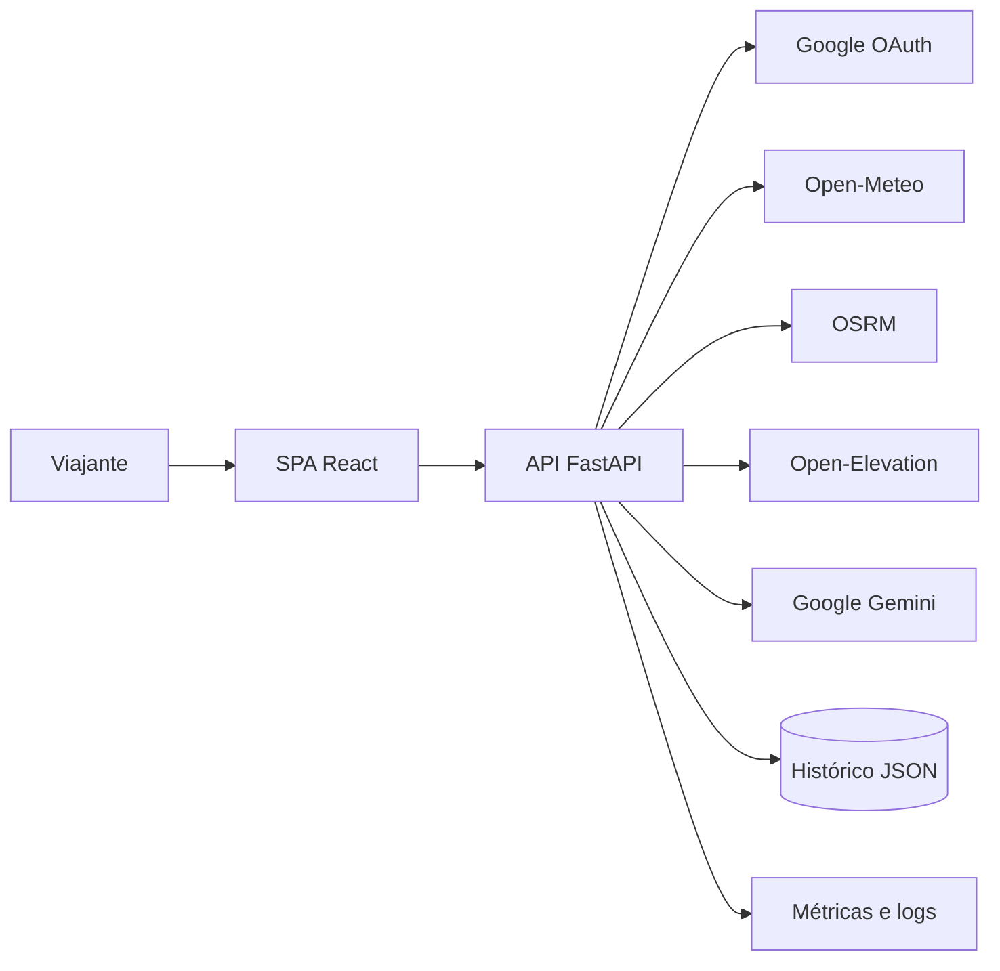

# Visão e escopo do produto

## Propósito

O **Guia do Turista Inteligente** apoia o planejamento rodoviário de uma viagem no Brasil em uma experiência web única. A solução combina rota, clima, relevo, autonomia, custos e conteúdo turístico gerado por IA, preservando histórico por usuário e oferecendo exportação e compartilhamento.

Esta visão é **derivada** da [Visão Geral](../modulo-guia-turista-inteligente.md#1-visão-geral) e de [Telas e Componentes](../modulo-guia-turista-inteligente.md#3-telas-e-componentes).

## Problema a resolver

O viajante precisa consultar múltiplas fontes para decidir destino, rota, condições climáticas, paradas, orçamento e atrações. O produto consolida essas informações e reduz o tempo de espera percebido por meio de processamento concorrente e transmissão progressiva do guia.

## Objetivos

| Objetivo | Resultado esperado | Estado |
| --- | --- | --- |
| O-01 | Planejar uma viagem rodoviária a partir de origem, destino e preferências. | Fonte |
| O-02 | Reunir clima, rota, altimetria, autonomia, custos e conteúdo turístico. | Fonte |
| O-03 | Entregar a resposta principal com baixa latência e conteúdo de IA progressivo. | Fonte |
| O-04 | Permitir uso autenticado pelo Google e uso temporário como visitante. | Fonte |
| O-05 | Manter histórico isolado por usuário e possibilitar retomada da sessão Google. | Fonte |
| O-06 | Oferecer uma interface responsiva e acessível. | Fonte |

## Atores

- **Viajante autenticado:** utiliza identidade Google e mantém seu histórico associado ao identificador ativo.
- **Visitante temporário:** utiliza uma sessão anônima com duração informada de duas horas.
- **Operador/desenvolvedor:** monitora saúde, prontidão, métricas, correlação de requisições e provedores externos.
- **Provedores externos:** Google OAuth/Gemini, Open-Meteo, OSRM e Open-Elevation.

Os papéis são **derivados** das seções [Estrutura dos Projetos](../modulo-guia-turista-inteligente.md#2-estrutura-dos-projetos), [Sessão Híbrida](../modulo-guia-turista-inteligente.md#36-sessão-híbrida) e [Telemetria e Desempenho](../modulo-guia-turista-inteligente.md#32-telemetria-e-desempenho).

## Escopo funcional

### Incluído

- autenticação Google, sessão visitante e alternância não destrutiva entre os modos;
- planejamento de roteiro com origem, destino, duração, perfil e parâmetros do veículo;
- recomendações de destinos baseadas na localização do navegador;
- obtenção de clima, rota rodoviária, alternativas, relevo e métricas do percurso;
- cálculo de autonomia, paradas, consumo, pedágios, emissões, custo total e rateio;
- guia turístico conciso gerado por IA e transmitido por SSE;
- catálogo de atrações e gastronomia, incluindo marcação de visita;
- histórico individual, remoção de roteiro e persistência em segundo plano;
- abertura no Google Maps, compartilhamento e exportação GPX 1.1;
- telemetria, métricas Prometheus, probes de saúde/prontidão e documentação OpenAPI.

### Fora do escopo confirmado

Os itens abaixo não aparecem na fonte e não devem ser assumidos sem decisão posterior:

- compra de passagens, hospedagem, combustível ou ingressos;
- navegação GPS curva a curva dentro da aplicação;
- edição colaborativa simultânea de um roteiro;
- aplicativo móvel nativo ou funcionamento offline completo;
- banco de dados relacional, cobrança, assinatura ou painel administrativo;
- garantia de disponibilidade ou precisão comercial de provedores gratuitos externos.

## Contexto do produto

A topologia é resumida a partir da [Arquitetura de Microsserviços](../modulo-guia-turista-inteligente.md#13-arquitetura-de-microsserviços).

## Restrições conhecidas

- Backend alvo em FastAPI/ASGI, servido na porta `8001` em desenvolvimento.
- Frontend alvo em React 19 com TypeScript e Vite+, usando o servidor Vite na porta `5173` em desenvolvimento. Esta é uma decisão aprovada do projeto que especializa a tecnologia indicada na fonte.
- Contratos de entrada e saída validados com Pydantic v2.
- Comunicação SPA/API por HTTP JSON e SSE, com CORS configurado.
- Uso de `httpx.AsyncClient` compartilhado para integrações do backend.
- Persistência descrita na fonte como arquivo JSON com escrita atômica e isolamento por usuário.

## Indicadores de sucesso

| Indicador | Referência desejada | Estado |
| --- | --- | --- |
| Latência do endpoint de planejamento | inferior a 1.000 ms na demonstração; aproximadamente 800 ms no cenário descrito | Fonte |
| Primeiro conteúdo do streaming | menos de 300 ms no cenário descrito | Fonte |
| Validação inválida | resposta HTTP 422 | Fonte |
| Provedores apresentados pela telemetria | 4/4 quando todos estiverem disponíveis | Fonte |
| Qualidade automatizada | suítes backend e frontend aprovadas | Fonte |
| Acessibilidade | objetivo WCAG 2.1 AA | Fonte |

As condições exatas de carga, rede, hardware e percentil não foram definidas; portanto, os números são metas de demonstração e precisam de um plano de medição antes de se tornarem SLOs.

## Questões em aberto

1. Qual conjunto de cidades brasileiras alimentará o autocomplete?
2. Qual política de retenção e limite do histórico deve ser aplicada?
3. Como identificar e proteger `X-User-Id` contra falsificação quando não houver token Google?
4. Quais provedores possuem fallback e quais dados mínimos caracterizam uma resposta degradada aceitável?
5. Qual fórmula e fonte oficial serão usadas para pedágios, emissões e preços de combustível/energia?
6. Qual contrato de consentimento e privacidade será aplicado à geolocalização e ao histórico?
7. Quais navegadores e tamanhos de tela compõem a matriz de suporte?
8. Os tempos de 800 ms e 300 ms serão medidos localmente, em homologação ou produção?

## Decisão tecnológica aprovada

A implementação adota **React 19 + TypeScript + Vite+**. A atividade permanece funcionalmente equivalente; arquivos `.js`/`.jsx` citados na fonte são implementados como `.ts`/`.tsx`. Consulte [ADR-001](../arquitetura/decisoes/ADR-001-typescript-e-vite-plus.md).

## Referências na fonte

- [1. Visão Geral](../modulo-guia-turista-inteligente.md#1-visão-geral)
- [1.3 Arquitetura de Microsserviços](../modulo-guia-turista-inteligente.md#13-arquitetura-de-microsserviços)
- [3. Telas e Componentes](../modulo-guia-turista-inteligente.md#3-telas-e-componentes)
- [4. Engenharia Assíncrona](../modulo-guia-turista-inteligente.md#4-engenharia-assíncrona)

